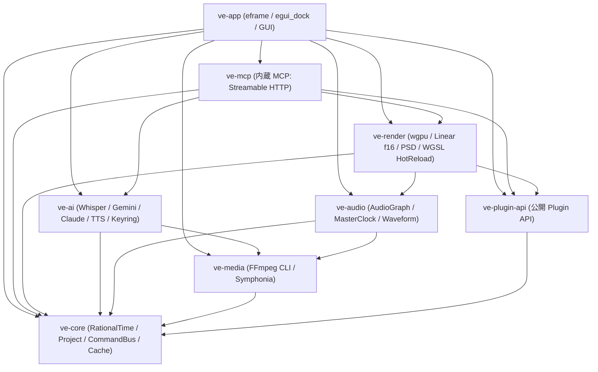

# アーキテクチャ設計書 (`video-editing-app_AG`)

## 1. ワークスペース依存関係

すべての機能を疎結合な 7 つの Rust クレートに分離し、コアエンジン・プラグイン API・レンダラー・MCP サーバー・GUI を独立してテスト・再利用できる構成としています。

## 2. 時間表現（有理数タイムベース）
* `ve_core::RationalTime` は `TICKS_PER_SECOND = 705_600_000`（Flicks）を採用しています。
* 24 / 23.976 / 29.97 / 30 / 59.94 / 60 / 120fps の映像フレームおよび 44.1kHz / 48kHz / 96kHz の音声サンプル位置を丸め誤差ゼロの整数で表現できます。

## 3. Command Bus と耐障害性
* GUI 操作と内蔵 MCP からの編集はすべて `ve_core::CommandBus::execute` を経由します。
* **Command Coalescing:** タイムラインドラッグ移動やスライダー連続操作は `coalesce_key` により 1 つの Undo 単位へ自動統合されます。
* **GUI ドラッグ排他ロック:** ユーザーがタイムラインやベジェハンドルをドラッグ中は `CommandSource::Mcp` を排他ブロックします。
* **クラッシュ復旧:** 実行成功したコマンドはプロジェクトフォルダの `history.jsonl` に即時追記・`sync_data()` され、クラッシュ後も `CommandBus::replay_history` で完全復旧できます。

## 4. レンダリングパイプラインとカラーマネジメント
1. **入力変換:** すべての素材（PNG / PSD / テキストグリフ / 映像フレーム）は入口で **Linear sRGB + Premultiplied Alpha** へ変換します。
2. **評価順序:**
   * Step 1: キーフレーム評価 → 立ち絵自動口パク（PSD 目パチ・口パク / PNG 差分） → オブジェクト個別エフェクトチェーン（組み込み & `ve-plugin-api`） → 3D カメラ透視投影・被写界深度ボケ
   * Step 2: トラックマット（Alpha / Luma ＆各反転） → グループ制御 → AviUtl2 風タイムラインフィルタオブジェクト（直上／範囲指定）
   * Step 3: 最終合成（3D カメラ有効時は奥から手前へ Z ソート） → `wgpu` (`Rgba16Float` → `composite.wgsl` → sRGB プレビュー) または FFmpeg 書き出し（MP4 / WebM VP9+Alpha / PNG 連番）

## 5. 内蔵 MCP サーバー仕様
* バインド先: `127.0.0.1:<ephemeral_port>`（`POST /mcp`、Streamable HTTP / JSON-RPC 2.0）
* 認証: アプリ起動ごとにランダム生成される `Authorization: Bearer <token>` が必須
* 公開ツール（24種）: 状態読み取り・`render_frame_preview`（PNG base64 視覚確認）・タイムライン編集・キーフレーム・Smart Precompose・トラックマット・3D カメラ・立ち絵・TTS ファイルペア取込・外部 API コスト見積り・プラグイン一覧・WGSL 静的検証・`batch_execute`
