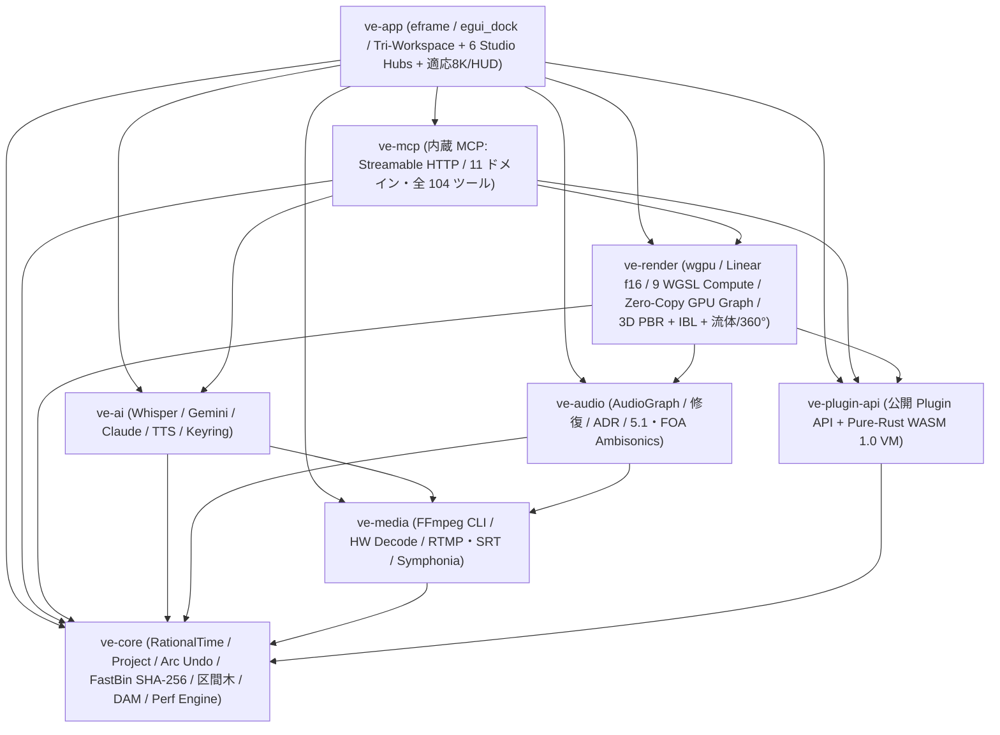

# アーキテクチャ設計書 (`video-editing-app_AG` — v11.0.0)

## 1. ワークスペース依存関係（8 クレート・Pure Rust・ゼロ `unsafe`）

すべての機能を疎結合な **8 つの Rust クレート** に分離し、コアエンジン・プラグイン API・レンダラー・MCP サーバー・GUI を独立してテスト・再利用できる構成としています。

### 大規模モジュールの責務分割（v10.0〜v11.0）
* `crates/core/src/command/` — `mod.rs`（`EditCommand` / `Arc<Project>` 共有 `CommandBus`）・`apply.rs`（決定論コマンド適用器）・`tests.rs`
* `crates/core/src/perf_engine.rs` — ゼロコピー GPU DAG プランナー・適応解像度 EMA＆スマート事前レンダリング・FastBin SHA-256 スナップショット＆メモリ監査・プロファイラ統計＆自動ボトルネック診断
* `crates/render/src/graph/` — `mod.rs`（`RenderGraph` コア合成＆`render_project_scene_profiled`＆並列バッチ描画）・`effects.rs`（エフェクトチェーン・トランジション・ブラー・回転）・`tests.rs`
* `crates/app/src/timeline/` — `mod.rs`（タイムライン描画＆操作）・`actions.rs`（ミニマップ・分割・コピペ・ジャンプカット・ビート検出・ヘルパー）・`tests.rs`
* `crates/mcp/src/tools/` — 11 ドメイン別サブモジュール（`edit_nle` / `vfx_motion` / `color_finishing` / `audio_voice` / `ai_collab` / `deliver_system` / `v70_unified` / `v80_cinema_audio` / `v90_broadcast_ecosystem` / `v100_spatial_cinema_os` / `v110_performance_gpu`）

## 2. 時間表現（有理数タイムベース）
* `ve_core::RationalTime` は `TICKS_PER_SECOND = 705_600_000`（Flicks）を採用しています。
* 24 / 23.976 / 29.97 / 30 / 59.94 / 60 / 120fps の映像フレームおよび 44.1kHz / 48kHz / 96kHz の音声サンプル位置を丸め誤差ゼロの整数で表現できます。

## 3. Command Bus と耐障害性・省メモリ永続化
* GUI・ハードウェアコントローラー（OSC/MIDI/Stream Deck）・内蔵 MCP からの編集はすべて `ve_core::CommandBus::execute` を経由します。
* **Undo `Arc<Project>` 共有 ＆ Command Coalescing:** 隣接 Undo スナップショット（`prev.after == cur.before`）を `Arc` で自動共有して RAM 消費量を約 50% 削減しつつ、連続操作は `coalesce_key` で 1 Undo 単位へ統合します。
* **GUI ドラッグ排他ロック:** ユーザーがタイムラインやベジェハンドルをドラッグ中は `CommandSource::Mcp` を排他ブロックします。
* **クラッシュ復旧 ＆ FastBin スナップショット:** 実行成功したコマンドは `history.jsonl` へ即時追記・`sync_data()` されるほか、Git フレンドリーな `project.json` に加えて RLE＋FIPS 180-4 SHA-256 整合性検証付き高速バイナリスナップショット（`cache/project.fastbin`）をサポートします。

## 4. レンダリングパイプライン・ゼロコピー WGSL Compute・カラーマネジメント
1. **入力変換:** すべての素材（PNG / PSD / テキストグリフ / 映像フレーム）は入口で **Linear sRGB + Premultiplied Alpha**（`Rgba16Float` 8 B/px 4K/8K フレームプール ＆ RAM プレビュー）へ変換します。
2. **評価順序 ＆ 適応スケーリング:**
   * Step 0: EMA ヒステリシス適応解像度（1/1→1/2→1/4・停止時 1/1 復帰）＋パス別マイクロ秒実測 `render_project_scene_profiled`
   * Step 1: 10,000+ クリップ区間木 $O(\log N)$ クエリ → キーフレーム＆エクスプレッション評価 → 立ち絵口パク・VTuber 2D メッシュ・2D Navier-Stokes 流体・PBD クロス・3D PBR（2 パス PCF ソフトシャドウマップ＆HDRI IBL） → 個別エフェクト＆WASM プラグイン＆ロトブラシ
   * Step 2: トラックマット（Alpha / Luma ＆各反転） → グループ制御 → AviUtl2 風タイムラインフィルタオブジェクト → シーンチェンジ
   * Step 3: 最終合成（3D Z ソート / ノード合成グラフ） → シネマ光学 VFX → ACEScg/OCIO＆3D LUT → 35mm フィニッシング → 360° 全天球（OverCapture / Tiny Planet / 水平ロック）＆ ステレオスコピック空間 3D パス → オプションのダークガラス調プロファイラ HUD
3. **組み込み WGSL Compute シェーダー（全 9 本・Naga 静的検証済・決定論 CPU フォールバック付）:**
   * `effects.wgsl` (v0.2) / `composite_compute.wgsl` (v1.0) / `color_grade_compute.wgsl` ＆ `video_scopes_compute.wgsl` (v3.0) / `fast_blend_mask.wgsl` ＆ `fast_aces_color_mgmt.wgsl` (v7.0) / `spatial_360_equirect.wgsl` ＆ `fluid_2d_advection.wgsl` (v10.0) / `zero_copy_composite_grade.wgsl` (v11.0 — 1 コマンドバッファ VRAM 常駐 Ping-Pong 連結)

## 5. 内蔵 MCP サーバー仕様（全 104 ツール / 11 ドメイン）
* バインド先: `127.0.0.1:<ephemeral_port>`（`POST /mcp`、Streamable HTTP / JSON-RPC 2.0）
* 認証: アプリ起動ごとにランダム生成される `Authorization: Bearer <token>` が必須
* 公開ツール（全 **104 種** / **11 ドメイン**）: タイムライン NLE・VFX/モーション・カラー/3D LUT/ACEScg・音声 DSP/修復/ADR/Ambisonics・AI ビジョン/ディレクター/CRDT・納品/WASM/QC・6 スタジオ Hub/GPU プール/区間木/A/B 比較・平面追跡/ロト/SVG ワープ/光学 VFX・ライブスイッチャー/VTuber VMC/OSC・MIDI・StreamDeck/スマート DAM・360° 空間 3D/流体・クロス・HDRI IBL/BVH・シルエットモキャップ/LAN 分散レンダーファーム/自律 AI シネマプロデューサー・ゼロコピー GPU グラフ/適応 8K 事前レンダリング/FastBin メモリ監査・コンパクション/リアルタイムプロファイラ＆自動ボトルネック診断まで完全網羅。
