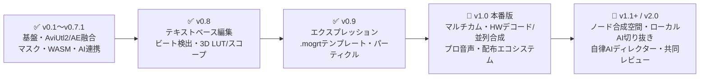

# 機能追加ロードマップ（Future Features Roadmap）

> 更新日: 2026-11-21  
> **v0.1〜v0.9 完了済み**: コアエンジン・AE 融合・音声 AI / 立ち絵 / 3D・PSD / WGSL / プラグイン・実メディア描画＆非同期書き出し・AviUtl2 実用機能群・無音自動カット・`wgpu` GPU オフロード・プレビュー直接操作ギズモ・RAM 先読みプレビュー・縦動画リフレーム・BGM 自動ダッキング＆オーディオリアクティブ・台本一括生成・SRT / ASS / `.exo` / OTIO 互換・レンダーキュー・自由ベジェマスク＆自動モーショントラッカー・Pure-Rust WASM サンドボックスプラグイン・AI ハイライト自動ショート生成・プリセット管理・テキストベース編集＆フィラー自動除去・BGM ビート自動検出＆スナップ・`.cube` 3D LUT＆3-Way カラーホイール＆リアルタイムビデオスコープ・Pure-Rust エクスプレッションエンジン・モーショングラフィックス＆プロジェクトテンプレート（`.mogrt` 相当）・決定論的 2D/3D パーティクル＆自由ベジェベクターシェイプ＆3D ライト＆シャッター角モーションブラー・全 50 MCP ツール。  
> 以下に **v0.8〜v0.9（✅ 実装済み）〜v1.0（プロダクション完成版）および v1.1+ / v2.0 ビジョンまでの全 24 項目** をマイルストーン順に整理しています。

## 全体マイルストーン俯瞰

| バージョン | テーマ | 含まれる項目 | ステータス |
| :--- | :--- | :--- | :---: |
| **v0.1〜v0.4** | コアエンジン・AE/AviUtl2 基礎・GPU オフロード・AI/MCP 基盤 | Phase 1a〜4, A-1〜A-6, B-1〜B-7 | ✅ 完了 |
| **v0.5** | 日常編集の直感操作・高速プレビュー・縦動画対応 | #1〜#3 | ✅ 完了 |
| **v0.6** | 量産ワークフロー・ダッキング・他ソフト互換・バッチ書き出し | #4〜#7 | ✅ 完了 |
| **v0.7 / v0.7.1** | ベジェマスク・トラッカー・WASM・ハイライト・プリセット＆UI 完成 | #8〜#10 + Polish | ✅ 完了 |
| **v0.8** | 爆速カット＆音ハメ＆カラーグレーディング強化 | **#11〜#13** | ✅ 完了 |
| **v0.9** | AE 級プロシージャル表現・テンプレート量産・高度 2D/3D 合成 | **#14〜#16** | ✅ 完了 |
| **v1.0** | プロダクション完成版（マルチカム・HW 並列性能・プロ音声・配布基盤） | **#17〜#20** | 🗓 予定 |
| **v1.1+ / v2.0** | 次世代 AI ＆ ノード合成・共同編集フロンティア | **#21〜#24** | 🔭 構想 |

---

## ✅ v0.8（実装済み）：爆速カット ＆ 音ハメ ＆ カラーグレーディング強化

### 11. ~~テキストベース編集（文字起こし連動リップルカット ＆ フィラー自動除去）~~ ✅ 実装済み（v0.8）
- **目的**: Premiere Pro / Descript のように、文字起こしテキストを文章エディタ感覚で削る・並べ替えるだけで動画本編を高速に粗編集できるようにする。
- **実装内容**:
  - `ve-core`: `text_edit` モジュール — 字幕・文字起こしタイムスタンプ区間と連動レイヤー（動画・音声・字幕等）を解決し、選択区間の削除（`build_text_based_delete_commands`）および前後スワップ並べ替え（`build_text_based_reorder_commands`）を 1 ステップ Undo 可能な `EditCommand::Batch` へ変換
  - `ve-core`: 日本語・英語フィラー検出（`analyze_fillers` / `extract_transcript_entries`）およびセリフ内フィラー語句一括掃除（`build_strip_filler_words_commands`）
  - `ve-app`: `AudioAi3DPanel` に文字起こし連動パネル（クリックシーク、複数選択＆1 クリック連動リップルカット、⬆/⬇ 並べ替え、フィラー一括カット＆語句掃除）を統合
  - `ve-mcp`: AI エージェントから実行できる `text_based_edit` ツール

### 12. ~~BGM ビート自動検出 ＆ ビートスナップ編集（音ハメ・MV・ショート動画向け）~~ ✅ 実装済み（v0.8）
- **目的**: 音楽のテンポ（BPM）と拍位置を自動解析し、カット割りやテロップ出現をリズムへ吸い付かせる。
- **実装内容**:
  - `ve-audio`: Pure-Rust 低域重み付きオンセット強度＋自己相関 BPM 推定＋位相アライメント（`detect_audio_beats` / `detect_beats_from_waveform`）
  - `ve-core`: ビート自動カット（`build_beat_cut_commands`）・最寄りビート整列（`build_snap_to_beats_commands`）・小節/全拍マーカー一括配置（`build_beat_markers_command`）
  - `ve-app`: タイムライン「🥁 ビート検出」バー・ビートグリッド縦線（小節頭ゴールド / 拍シアン）・ドラッグ/トリムのビート自動吸着
  - `ve-mcp`: BGM 解析・ビートマーカー配置・音ハメカットを行う `detect_beats` ツール

### 13. ~~`.cube` 3D LUT 対応 ＆ リアルタイム色調スコープ（Waveform / Parade / Vectorscope）~~ ✅ 実装済み（v0.8）
- **目的**: 映画調・Vlog 調の色作りをプロ品質で再現し、目視に頼らず客観的な露出・色バランス確認を可能にする。
- **実装内容**:
  - `ve-render`: Adobe / DaVinci Resolve 標準 `.cube` 3D LUT パーサ＋四面体補間（`CubeLut3D::sample_tetrahedral`）、組み込みシネマルック 3 種＋`emit_sample_cube_luts`、および `RenderGraph` 最終段統合（プレビュー／RAM／書き出し／MCP 完全一致）
  - `ve-core` / `ve-render`: 非破壊 `SceneColorGrade`（露出・コントラスト・彩度・色温度・ティント・3-Way Lift/Gamma/Gain・LUT 強度）と `EditCommand::SetSceneColorGrade`（Undo 対応）
  - `ve-render` / `ve-app`: ドラッグ操作可能な 3-Way カラーホイール＆`.cube` ブラウザ、およびリアルタイムビデオスコープ（輝度 Waveform・RGB パレード・ベクトルスコープ・RGBY ヒストグラム・4 分割表示＋IRE/Clip/Crush 統計）
  - `ve-mcp`: カラーグレーディング＆LUT 適用・サンプル生成を行う `set_color_grade` ツール

---

## ✅ v0.9（実装済み）：AE 級プロシージャル演出 ＆ テンプレート量産

### 14. ~~Pure-Rust エクスプレッションエンジン（式アニメーション）~~ ✅ 実装済み（v0.9）
- **目的**: キーフレームを手打ちせずに、自然なカメラ揺れ・無限ループ・音声連動・他レイヤー追従を数行の式で記述できるようにする。
- **実装内容**:
  - `ve-core`: `expression` モジュール — ゼロ `unsafe`・決定論的サンドボックス再帰下降パーサ＆ステップ上限付きバイトコード VM（`time`, `local_time`, `duration`, `progress`, `fps`, `frame`, `value`, `wiggle(freq, amp[, octaves])`, `noise`, `random`, `sin`/`cos`/`pow`/`clamp`/`linear`/`ease`, `loopOut("cycle"|"pingpong"|"offset"|"continue")`, `audio_band("low"|"mid"|"high"|"rms")`, `layer("名前").x`）＋キーフレーム焼き込み `build_bake_expression_command`
  - `ve-app`: インスペクタ式エディタ（リアルタイム評価値・構文エラー即時表示・プリセットスニペット・Bake ボタン）およびグラフエディタ上の式カーブ可視化（紫ライン＋ワンクリック Bake）
  - `ve-mcp`: AI が式の設定・解除・評価・Bake を行える `set_expression` ツール

### 15. ~~モーショングラフィックス テンプレート（`.mogrt` 相当）＆ プロジェクトテンプレート~~ ✅ 実装済み（v0.9）
- **目的**: 凝った OP/ED・見出しテロップ・告知カードを一度作れば、以後はタイトル文言や色・画像を差し替えるだけで何度でも量産できるようにする。
- **実装内容**:
  - `ve-core`: `template` モジュール — `MotionTemplate` / `TemplateBinding` / `ProjectTemplate`、レスポンシブ時間伸縮 `apply_responsive_time_stretch`（イントロ／アウトロ保護・中間のみ伸縮）、標準モーショングラフィックス 3 種＆プロジェクト雛形 3 種、`ProjectFolder` の `templates/*.json` / `templates/projects/*.json` 永続化 CRUD、`EditCommand::UpdateTemplateInstance`（Undo 対応）
  - `ve-app`: テンプレートギャラリーからのワンクリック配置、選択時に公開パラメータだけを集約した専用編集カード、現シーンのテンプレート保存、およびプロジェクト雛形からの新規作成／保存 UI
  - `ve-mcp`: テンプレート一覧・配置・公開パラメータ差し替え・シーン保存を行う `manage_templates` ツール

### 16. ~~高度な 2D/3D 合成：パーティクル・自由ベクターシェイプ・モーションブラー~~ ✅ 実装済み（v0.9）
- **目的**: 外部素材に頼らずソフト単体で高品質なモーショングラフィックス・演出エフェクトを完結できるようにする。
- **実装内容**:
  - `ve-core` / `ve-render`: 決定論的シード 2D/3D パーティクルエミッター `ParticleEmitter`（紙吹雪・雪・火花・光粒・集中線・スピードライン、シークしても完全一致）
  - `ve-core` / `ve-render`: 自由ベジェベクターシェイプ `VectorShape`（単色・線形グラデーション塗り・破線ストローク・**トリムパスアニメーション** `trim_start`/`trim_end`/`trim_offset`、星/矢印/ウェーブ下線/吹き出し/破線リング）
  - `ve-core` / `ve-render` / `ve-app` / `ve-mcp`: 3D カメラ空間のディレクショナル／ポイントライト＆ドロップシャドウキャッチャー（`Light3D`）、シャッター角度ベース サブフレーム合成モーションブラー（プレビュー軽量 / 書き出し高品質自動切替 `MotionBlurConfig`）、および MCP `set_scene_motion_blur` ツール（全 **50 MCP ツール**）

---

## 🎯 v1.0（プロダクション完成版マイルストーン）：長尺・大規模・プロ品質の完成

### 17. マルチカメラ編集 ＆ 音声相互相関による自動同期
- **目的**: 複数カメラ撮影・画面録画＋別録り高音質マイク・コラボ配信素材をワンクリックで完全同期し、テンポ良くスイッチング編集できるようにする。
- **実装内容**:
  - `ve-audio`: 音声相互相関（Cross-Correlation）によるサブフレーム精度の自動オフセット検出と一括タイムライン整列
  - `ve-app`: マルチカムクリップ（2×2 / 3×3 同時プレビューグリッド）と、再生しながら数字キー（`1`〜`9`）押下でリアルタイムにカメラ切替カットを打つライブスイッチングモード
  - `ve-mcp`: 複数クリップの自動同期・マルチカム組立てを行う `sync_multicam` ツール

### 18. パフォーマンス革命：HW デコード ＆ マルチスレッド並列合成 ＆ 永続ディスクキャッシュ
- **目的**: 4K 60fps・多レイヤー・長時間（30 分〜2 時間）プロジェクトでもストレスなく軽快に動作する商用ソフト並みの応答性を実現する。
- **実装内容**:
  - `ve-media`: FFmpeg ハードウェアデコード（Windows `d3d11va` / `dxva2`、Linux `vaapi`、macOS `videotoolbox`）の自動検出・有効化＆安全フォールバック、自動バックグラウンドプロキシ生成キュー（解像度・コーデック設定可）
  - `ve-render`: 並列ワーカーによる複数レイヤー評価＆書き出しフレーム先読み並列レンダリング、および CPU 合成から `wgpu` コンピュートシェーダーコンポジタへの段階的全面移行
  - `ve-core` / `ve-app`: SSD 永続フレームキャッシュ（`cache/frames/` コンテンツハッシュ＋LRU 上限管理）により、アプリ再起動後もキャッシュ済み区間を即座に再生可能に

### 19. ノンリニア編集プロ機能 ＆ 音声ポストプロダクション完成
- **目的**: 実務の長尺編集・仕上げ作業で必要になる細部の NLE 操作と音声マスタリング機能を網羅する。
- **実装内容**:
  - タイムライン高度操作: スリップ／スライド／ロールトリム、クリップグルーピング＆映像/音声リンク解除、タイムライン上のボリューム／パン オートメーションカーブ直接描画、オーディオトラックミキサー（バス／センド／ソロ／パン）、マイク直接アフレコ録音
  - 音声クリーンアップ: Pure-Rust スペクトル減算ノイズリダクション＆ディエッサー、ローカル音声分離（ボーカル / BGM 分離）連携
  - 仕上げ・受け渡し: プロジェクト検証チェックリスト（オフライン素材・クリッピング・フレーム落ち検出）、アーカイブ Zip パッケージ化、カラーマネージメント（Rec.709 / HDR PQ 10-bit 書き出し対応）

### 20. v1.0 品質保証・カスタマイズ・配布エコシステム
- **目的**: OSS プロジェクトとして誰もが安心して日常利用・拡張開発・配布できる完成度へ仕上げる。
- **実装内容**:
  - カスタムキーバインド設定 UI（Premiere / DaVinci / AviUtl2 / After Effects 風キーマップ切替＆JSON インポート/エクスポート）
  - 多言語 UI（日本語 / 英語）＆ UI テーマ／フォントサイズ調整＆アクセシビリティ強化
  - WASM プラグイン・WGSL シェーダー・プリセット・テンプレートの公式インデックス＆アプリ内導入ブラウザ（SHA-256 署名検証・サンドボックス権限明示）
  - 配布自動化: Windows インストーラー（MSI / `winget` マニフェスト）・macOS Universal Bundle・Linux AppImage の自動リリースと、ゴールデン画像比較による視覚回帰テストスイート

---

## 🚀 v1.1+ / v2.0 ビジョン（次世代 AI ＆ ノード合成フロンティア）

### 21. ノードベース合成グラフ（第 3 ワークスペース：Fusion / Nuke スタイル）
- **構想**: 現在の 2 空間（メイン編集空間 / モーション合成空間）に加え、複雑なエフェクト分岐・チャンネル分離（RGB/Alpha/Depth）・マスク合流・3D 合成パスを視覚的に配線できる「ノード合成空間」を導入。既存 `RenderGraph` と双方向変換し、レイヤー編集とノード合成をシームレスに往復可能にする。

### 22. ローカル AI セグメンテーション ＆ インテリジェント自動リフレーム
- **構想**: オプショナルなローカル推論バックエンド（ONNX Runtime 等、オフライン完結・クラウド送信ゼロ）を連携し、グリーンバック不要の人物切り抜き（自動ロトブラシ）、被写体・顔追尾による 16:9→9:16 自動パンリフレーム、ローカル超解像・オプティカルフロー補間による滑らかスローモーションを実現。

### 23. マルチエージェント AI 編集ディレクター（MCP オーケストレーション ＆ 編集レシピ）
- **構想**: 内蔵 MCP（44+ ツール）を土台に、「企画・台本 → 素材選定 → 粗編集 → テロップ・BGM・SE 配置 → `render_frame_preview` 視覚自己検査 → 修正」を人間承認ゲート付きで反復支援する編集レシピ（再現可能なマクロ YAML/JSON）の記録・共有基盤を構築。

### 24. 共同編集・差分マージ ＆ タイムコードレビュー（Git-Friendly NLE）
- **構想**: 1 フォルダ管理＋決定論的 JSON スキーマの強みを最大限に活かし、タイムラインの視覚的 Diff 比較・ブランチマージ・タイムコード付きレビューコメント（Frame.io / YouTube 限定公開レビュー互換 CSV/JSON インポート＆マーカー自動変換）を実現。

---

## ✅ 実装完了アーカイブ（v0.1〜v0.7.1）

### v0.7.1（✅ 実装済み）：v0.3〜v0.4 残課題の完全補完
- **字幕スタイル＆エフェクトチェーン プリセット管理（`presets/*.json`）＋ 影色・座布団色 RGBA ピッカー**: `TextStylePreset`（標準 4 種）・`EffectPreset::default_presets()`（標準 3 チェーン）、`ProjectFolder` 永続化 CRUD、インスペクタ 1 クリック適用/保存/右クリック削除、MCP `manage_presets`（全 44 ツール）。
- **専用インスペクタ拡充**: `FilterObject`・`GroupControl`・`AudioSpectrum` の専用編集 UI および Undo コマンド（`SetFilterObject` / `SetGroupControl` / `SetAudioSpectrum`）。
- **タイムラインショートカット補完＆マーカー編集**: `Ctrl+C`/`V`/`D`/`A`、`Backspace`（`Shift` でリップル削除）、`Home`/`End`、`EditCommand::UpdateMarker`＋ルーラークリックでのラベル＆5 色パレットその場編集、MCP `manage_markers` `update`。
- **UI 整理＆ドキュメント最新化**: 旧 Phase 1a / Phase 2 仮文言クリーンアップ、`README.md` / `CHANGELOG.md` 最新化。

### v0.7（✅ 実装済み）：上級映像表現 ＆ エコシステム拡張（#8〜#10）
- **#8 自由ベジェマスク ＆ 自動モーショントラッキング**: 3 次ベジェ閉曲線マスク `BezierMask`（加算/減算/反転/2 パスフェザー）、プレビュー頂点＆接線ハンドル直接ドラッグ、Pure-Rust 1 ポイント自動モーショントラッカー `track_point_in_scene`＋`x`/`y` キーフレーム焼き込み、MCP `set_bezier_mask`。
- **#9 WASM（WebAssembly）動的プラグインロード**: Pure-Rust・ゼロ `unsafe`・外部依存ゼロの WebAssembly 1.0 サンドボックス VM（インポート禁止・4MiB メモリ境界・フューエル上限）、`plugins/*.wasm` 500ms ホットリロード＆破損時自動ロールバック、サンプル `.wasm` 3 種ビルダー、MCP `list_or_reload_wasm_plugins`。
- **#10 AI ハイライト自動抽出 ＆ ショート動画自動切り抜き**: 音声ピーク・字幕密度・強調語・マーカーの複合スコア＋NMS 非重複抽出 `extract_highlight_candidates`、1080×1920（9:16）自動トリム＆セーフゾーン 13 文字改行リレイアウト `build_shorts_clip_scene_command`、MCP `extract_highlights`。

### v0.6（✅ 実装済み）：解説・実況・ショート動画の量産機能（#4〜#7）
- **#4 BGM 自動ダッキング＆オーディオリアクティブ**: サイドチェイン音声ダッキング `apply_sidechain_ducking`、Goertzel 対数帯域スペクトラム解析、`ItemKind::AudioSpectrum`、`AudioReactiveConfig`、MCP `set_audio_ducking`。
- **#5 台本（Markdown / CSV）→ タイムライン一括自動生成**: `parse_script_csv` / `parse_script_markdown` / `build_script_timeline_commands`、ローカル TTS 実尺連携、MCP `import_script`。
- **#6 SRT / ASS 字幕入出力 ＆ 他ソフト互換**: Pure-Rust SRT / ASS 入出力、AviUtl `.exo`（UTF-16LE 16 進日本語復号対応）インポート、OpenTimelineIO `.otio` エクスポート、MCP `import_subtitles_or_exo` / `export_subtitles_or_otio`。
- **#7 レンダーキュー（バッチ連続書き出し）**: マルチジョブ連続書き出し、9:16 縦動画自動リフレーム書き出し、1 クリック「YouTube 一括セット追加」、進捗表示・キャンセル。

### v0.5（✅ 実装済み）：日常編集の直感操作・高速プレビュー・縦動画対応（#1〜#3）
- **#1 プレビュー画面上の直接操作（Transform Gizmo ＆ ガイド線）**: 直接選択・四隅スケール・回転ハンドル・中央/セーフマージン吸着ガイド・9:16 UI 被り警告・ホイールズーム＆パン、線形空間バイリニア回転描画。
- **#2 動画デコード高速化 ＆ RAM プレビュー**: 常駐 FFmpeg ストリームデコーダ `VideoStreamDecoder`、専用ワーカースレッド 96 フレーム先読み `RamPreviewManager`、ルーラー下緑色キャッシュバー。
- **#3 シーン設定 UI・OS ネイティブファイル選択・自動保存**: `ScenePreset`（720p / 1080p / 4K / 9:16 / 1:1）＆自動リフレーム、ゼロ依存 OS ネイティブダイアログ、`backups/` 自動保存ローテーション、MCP `set_scene_settings`。

### v0.1〜v0.4（✅ 実装済み）：コア基盤 ＆ AviUtl2 / AE 実用機能群
- **v0.1〜v0.2**: 有理数タイムベース、`CommandBus`（Undo/Redo・Coalescing・`history.jsonl` 復旧）、Smart Precompose＆ハッシュ LRU キャッシュ、3D カメラ＆被写界深度、立ち絵自動口パク（PNG 差分 / PSD ネイティブ）、カスタム WGSL ホットリロード、実メディア描画＆非同期書き出し。
- **v0.3**: AviUtl2 本体実用機能 A-1〜A-6（カラーパレット・制御文字・レイヤー設定・シーンチェンジ・再生速度/逆再生/ループ・実務フィルタ）、人気プラグイン相当機能 B-1〜B-7（整列/隙間詰め/ミニマップ・フォントピッカー・音声 DSP 8 種＆LUFS・エイリアス棚・検索置換・フォルダ監視・演出プリセット）。
- **v0.4**: 無音区間自動カット（ジェットカット）、`wgpu` Ping-Pong GPU オフロード＆ヘッドレス書き出し、Claude 字幕文脈補正差分 UI＆MCP 強化、キーボードショートカット＆マーカー＆ラバーバンド選択＆リップル削除、GitHub Releases 自動配布パイプライン。
