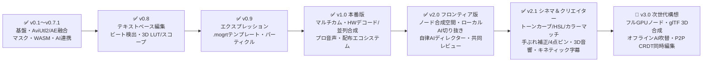

# 機能追加ロードマップ（Future Features Roadmap）

> 更新日: 2026-11-21  
> **v0.1〜v2.1 全 28 項目完了済み**: コアエンジン・AE 融合・音声 AI / 立ち絵 / 3D・PSD / WGSL / プラグイン・実メディア描画＆非同期書き出し・AviUtl2 実用機能群・無音自動カット・`wgpu` GPU オフロード・プレビュー直接操作ギズモ・RAM 先読みプレビュー・縦動画リフレーム・BGM 自動ダッキング＆オーディオリアクティブ・台本一括生成・SRT / ASS / `.exo` / OTIO 互換・レンダーキュー・自由ベジェマスク＆自動モーショントラッカー・Pure-Rust WASM サンドボックスプラグイン・AI ハイライト自動ショート生成・プリセット管理・テキストベース編集＆フィラー自動除去・BGM ビート自動検出＆スナップ・`.cube` 3D LUT＆3-Way カラーホイール＆リアルタイムビデオスコープ・Pure-Rust エクスプレッションエンジン・モーショングラフィックス＆プロジェクトテンプレート（`.mogrt` 相当）・決定論的 2D/3D パーティクル＆自由ベジェベクターシェイプ＆3D ライト＆シャッター角モーションブラー・マルチカメラ編集＆音声相互相関自動同期・HW デコード＆並列書き出し＆`wgpu` コンピュートコンポジタ＆SSD 永続フレームキャッシュ・プロ NLE トリム＆トラックミキサー＆マイク録音＆スペクトル NR/ディエッサー/ボーカル分離・納品検証＆ZIP アーカイブ＆HDR10 PQ 10-bit・カスタムキーバインド/多言語/テーマ/SHA-256 公式拡張レジストリ/マルチ OS 配布＆ゴールデン視覚回帰テスト・第 3 ワークスペース「ノード合成空間（Fusion/Nuke スタイル）」＆双方向レイヤー同期・完全オフライン ローカル AI ビジョン・マルチエージェント AI 編集ディレクター・Git-Friendly NLE 視覚タイムライン Diff＆3-Way マージ＆Frame.io/YouTube レビュー・**RGB/マスタートーンカーブ＆HSL 二次色補正クオリファイア＆ショット間自動カラーマッチ・自動 2D 手ぶれ補正＆平面 4 点コーナーピン射影合成・3D バイノーラル空間オーディオ＆3 バンドマルチバンドコンプ＆4× True-Peak リミッター・ワード単位キネティック字幕＆多言語ローカライズ CSV 一括切替・全 62 MCP ツール**。  
> 以下に **v0.8〜v2.1（✅ 全 28 項目実装済み）** および次世代 **v3.0 構想（#29〜#32）** を整理しています。

## 全体マイルストーン俯瞰

| バージョン | テーマ | 含まれる項目 | ステータス |
| :--- | :--- | :--- | :---: |
| **v0.1〜v0.4** | コアエンジン・AE/AviUtl2 基礎・GPU オフロード・AI/MCP 基盤 | Phase 1a〜4, A-1〜A-6, B-1〜B-7 | ✅ 完了 |
| **v0.5** | 日常編集の直感操作・高速プレビュー・縦動画対応 | #1〜#3 | ✅ 完了 |
| **v0.6** | 量産ワークフロー・ダッキング・他ソフト互換・バッチ書き出し | #4〜#7 | ✅ 完了 |
| **v0.7 / v0.7.1** | ベジェマスク・トラッカー・WASM・ハイライト・プリセット＆UI 完成 | #8〜#10 + Polish | ✅ 完了 |
| **v0.8** | 爆速カット＆音ハメ＆カラーグレーディング強化 | **#11〜#13** | ✅ 完了 |
| **v0.9** | AE 級プロシージャル表現・テンプレート量産・高度 2D/3D 合成 | **#14〜#16** | ✅ 完了 |
| **v1.0** | プロダクション完成版（マルチカム・HW 並列性能・プロ音声・配布基盤） | **#17〜#20** | ✅ 完了 |
| **v2.0** | 次世代 AI ＆ ノード合成・共同編集フロンティア | **#21〜#24** | ✅ 完了 |
| **v2.1** | シネマ＆クリエイタースタジオ（プロ色調・VFX・3D 空間音響・キネティック字幕） | **#25〜#28** | ✅ 完了 |
| **v3.0** | 次世代フル GPU ＆ 3D ワールド ＆ オフライン AI 吹替 ＆ リアルタイム共同編集 | **#29〜#32** | 🔭 構想中 |

---

## ✅ v0.8（実装済み）：爆速カット ＆ 音ハメ ＆ カラーグレーディング強化

### 11. ~~テキストベース編集（文字起こし連動リップルカット ＆ フィラー自動除去）~~ ✅ 実装済み（v0.8）
- **目的**: Premiere Pro / Descript のように、文字起こしテキストを文章エディタ感覚で削る・並べ替えるだけで動画本編を高速に粗編集できるようにする。
- **実装内容**:
  - `ve-core`: `text_edit` モジュール — 字幕・文字起こしタイムスタンプ区間と連動レイヤー（動画・音声・字幕等）を解決し、選択区間の削除（`build_text_based_delete_commands`）および前後スワップ並べ替え（`build_text_based_reorder_commands`）を 1 ステップ Undo 可能な `EditCommand::Batch` へ変換
  - `ve-core`: 日本語・英語フィラー検出（`analyze_fillers` / `extract_transcript_entries`）およびセリフ内フィラー語句一括掃除（`build_strip_filler_words_commands`）
  - `ve-app`: `AudioAi3DPanel` に文字起こし連動パネル（クリックシーク、複数選択＆1 クリック連動リップルカット、⬆/⬇ 並べ替え、フィラー一括カット＆語句掃除）を統合
  - `ve-mcp`: AI エージェントから実行できる `text_based_edit` ツール

### 12. ~~BGM ビート自動検出 ＆ ビートスナップ編集（音ハメ・MV・ショート動画向け）~~ ✅ 実装済み（v0.8）
- **目的**: 音楽のテンポ（BPM）と拍位置を自動解析し、カット割りやテロップ出現をリズムへ吸い付かせる。
- **実装内容**:
  - `ve-audio`: Pure-Rust 低域重み付きオンセット強度＋自己相関 BPM 推定＋位相アライメント（`detect_audio_beats` / `detect_beats_from_waveform`）
  - `ve-core`: ビート自動カット（`build_beat_cut_commands`）・最寄りビート整列（`build_snap_to_beats_commands`）・小節/全拍マーカー一括配置（`build_beat_markers_command`）
  - `ve-app`: タイムライン「🥁 ビート検出」バー・ビートグリッド縦線（小節頭ゴールド / 拍シアン）・ドラッグ/トリムのビート自動吸着
  - `ve-mcp`: BGM 解析・ビートマーカー配置・音ハメカットを行う `detect_beats` ツール

### 13. ~~`.cube` 3D LUT 対応 ＆ リアルタイム色調スコープ（Waveform / Parade / Vectorscope）~~ ✅ 実装済み（v0.8）
- **目的**: 映画調・Vlog 調の色作りをプロ品質で再現し、目視に頼らず客観的な露出・色バランス確認を可能にする。
- **実装内容**:
  - `ve-render`: Adobe / DaVinci Resolve 標準 `.cube` 3D LUT パーサ＋四面体補間（`CubeLut3D::sample_tetrahedral`）、組み込みシネマルック 3 種＋`emit_sample_cube_luts`、および `RenderGraph` 最終段統合（プレビュー／RAM／書き出し／MCP 完全一致）
  - `ve-core` / `ve-render`: 非破壊 `SceneColorGrade`（露出・コントラスト・彩度・色温度・ティント・3-Way Lift/Gamma/Gain・LUT 強度）と `EditCommand::SetSceneColorGrade`（Undo 対応）
  - `ve-render` / `ve-app`: ドラッグ操作可能な 3-Way カラーホイール＆`.cube` ブラウザ、およびリアルタイムビデオスコープ（輝度 Waveform・RGB パレード・ベクトルスコープ・RGBY ヒストグラム・4 分割表示＋IRE/Clip/Crush 統計）
  - `ve-mcp`: カラーグレーディング＆LUT 適用・サンプル生成を行う `set_color_grade` ツール

---

## ✅ v0.9（実装済み）：AE 級プロシージャル演出 ＆ テンプレート量産

### 14. ~~Pure-Rust エクスプレッションエンジン（式アニメーション）~~ ✅ 実装済み（v0.9）
- **目的**: キーフレームを手打ちせずに、自然なカメラ揺れ・無限ループ・音声連動・他レイヤー追従を数行の式で記述できるようにする。
- **実装内容**:
  - `ve-core`: `expression` モジュール — ゼロ `unsafe`・決定論的サンドボックス再帰下降パーサ＆ステップ上限付きバイトコード VM（`time`, `local_time`, `duration`, `progress`, `fps`, `frame`, `value`, `wiggle(freq, amp[, octaves])`, `noise`, `random`, `sin`/`cos`/`pow`/`clamp`/`linear`/`ease`, `loopOut("cycle"|"pingpong"|"offset"|"continue")`, `audio_band("low"|"mid"|"high"|"rms")`, `layer("名前").x`）＋キーフレーム焼き込み `build_bake_expression_command`
  - `ve-app`: インスペクタ式エディタ（リアルタイム評価値・構文エラー即時表示・プリセットスニペット・Bake ボタン）およびグラフエディタ上の式カーブ可視化（紫ライン＋ワンクリック Bake）
  - `ve-mcp`: AI が式の設定・解除・評価・Bake を行える `set_expression` ツール

### 15. ~~モーショングラフィックス テンプレート（`.mogrt` 相当）＆ プロジェクトテンプレート~~ ✅ 実装済み（v0.9）
- **目的**: 凝った OP/ED・見出しテロップ・告知カードを一度作れば、以後はタイトル文言や色・画像を差し替えるだけで何度でも量産できるようにする。
- **実装内容**:
  - `ve-core`: `template` モジュール — `MotionTemplate` / `TemplateBinding` / `ProjectTemplate`、レスポンシブ時間伸縮 `apply_responsive_time_stretch`（イントロ／アウトロ保護・中間のみ伸縮）、標準モーショングラフィックス 3 種＆プロジェクト雛形 3 種、`ProjectFolder` の `templates/*.json` / `templates/projects/*.json` 永続化 CRUD、`EditCommand::UpdateTemplateInstance`（Undo 対応）
  - `ve-app`: テンプレートギャラリーからのワンクリック配置、選択時に公開パラメータだけを集約した専用編集カード、現シーンのテンプレート保存、およびプロジェクト雛形からの新規作成／保存 UI
  - `ve-mcp`: テンプレート一覧・配置・公開パラメータ差し替え・シーン保存を行う `manage_templates` ツール

### 16. ~~高度な 2D/3D 合成：パーティクル・自由ベクターシェイプ・モーションブラー~~ ✅ 実装済み（v0.9）
- **目的**: 外部素材に頼らずソフト単体で高品質なモーショングラフィックス・演出エフェクトを完結できるようにする。
- **実装内容**:
  - `ve-core` / `ve-render`: 決定論的シード 2D/3D パーティクルエミッター `ParticleEmitter`（紙吹雪・雪・火花・光粒・集中線・スピードライン、シークしても完全一致）
  - `ve-core` / `ve-render`: 自由ベジェベクターシェイプ `VectorShape`（単色・線形グラデーション塗り・破線ストローク・**トリムパスアニメーション** `trim_start`/`trim_end`/`trim_offset`、星/矢印/ウェーブ下線/吹き出し/破線リング）
  - `ve-core` / `ve-render` / `ve-app` / `ve-mcp`: 3D カメラ空間のディレクショナル／ポイントライト＆ドロップシャドウキャッチャー（`Light3D`）、シャッター角度ベース サブフレーム合成モーションブラー（プレビュー軽量 / 書き出し高品質自動切替 `MotionBlurConfig`）、および MCP `set_scene_motion_blur` ツール

---

## ✅ v1.0（実装済み・プロダクション完成版）：長尺・大規模・プロ品質の完成

### 17. ~~マルチカメラ編集 ＆ 音声相互相関による自動同期~~ ✅ 実装済み（v1.0）
- **目的**: 複数カメラ撮影・画面録画＋別録り高音質マイク・コラボ配信素材をワンクリックで完全同期し、テンポ良くスイッチング編集できるようにする。
- **実装内容**:
  - `ve-audio`: 2 段階正規化相互相関（500Hz RMS エンベロープ粗探索 → 8kHz 波形精密探索、`estimate_audio_offset_xcorr`）によるサブフレーム精度（0.125ms）の自動オフセット検出
  - `ve-core` / `ve-app`: 一括同期整列（`build_multicam_sync_align_commands`）・2×2 / 3×3 同時プレビューグリッド＆数字キー `1`〜`9` ライブスイッチング記録・タイムライン確定（`build_multicam_switch_cut_commands`）
  - `ve-mcp`: 複数カメラの自動同期＆切替カット組み立てを行う `sync_multicam` ツール

### 18. ~~パフォーマンス革命：HW デコード ＆ マルチスレッド並列合成 ＆ 永続ディスクキャッシュ~~ ✅ 実装済み（v1.0）
- **目的**: 4K 60fps・多レイヤー・長時間プロジェクトでも軽快に動作する商用ソフト並みの応答性を実現する。
- **実装内容**:
  - `ve-media`: FFmpeg HW デコード自動検出（`d3d11va` / `dxva2` / `vaapi` / `videotoolbox`）＆安全 Software フォールバック（`open_video_stream_with_hwaccel`）、解像度・コーデック可変プロキシ生成（`ProxyProfile` / `ProxyCodec::H264Fast` / `MjpegIntra`）
  - `ve-render`: マルチスレッド並列バッチレンダリング（`render_frame_batch_parallel`）と、`@compute @workgroup_size(8, 8)` WGSL コンピュートシェーダーコンポジタ（`WgpuComputeCompositor` / `composite_compute.wgsl`）
  - `ve-core` / `ve-app`: SSD 永続フレームキャッシュ（`PersistentFrameCache` / `cache/frames/` コンテンツハッシュ＋LRU 管理）を `RenderGraph` と `RamPreviewManager` へ統合し、再起動後もキャッシュ済みフレームを即時再利用

### 19. ~~ノンリニア編集プロ機能 ＆ 音声ポストプロダクション完成~~ ✅ 実装済み（v1.0）
- **目的**: 実務の長尺編集・仕上げ作業で必要になる細部の NLE 操作と音声マスタリング機能を網羅する。
- **実装内容**:
  - タイムライン高度操作: スリップ／ロール／スライドトリム（`EditCommand::SlipTrim` / `RollTrim` / `SlideTrim`）、クリップグルーピング＆A/V リンク解除（`Ctrl+G` / `Ctrl+Shift+G` / `SetGroupId`）、タイムライン上のボリューム（黄）・パン（シアン）オートメーションカーブ直接描画、トラックミキサー（`SetLayerMixer`：フェーダー/パン/ソロ/ミュート/バス/Aux リバーブセンド）、マイク直接アフレコ録音（`VoiceoverRecorder`）
  - 音声クリーンアップ: Pure-Rust STFT スペクトル減算ノイズリダクション（`noise_reduction`）、ダイナミック LPF ディエッサー（`de_esser`）、オフライン Mid/Side＋帯域ボーカル／BGM 分離（`separate_vocal_bgm_stems`）
  - 仕上げ・受け渡し: 書き出し前検証チェックリスト（`validate_project_delivery`）、Pure-Rust IEEE CRC-32 ZIP アーカイブパッケージ化（`archive_project_to_zip`）、Rec.709 SDR タグ＆HDR10 PQ 10-bit（BT.2020 / ST 2084 / `yuv420p10le`）書き出し、MCP `nle_pro_edit` / `validate_and_package_project`

### 20. ~~v1.0 品質保証・カスタマイズ・配布エコシステム~~ ✅ 実装済み（v1.0）
- **目的**: OSS プロジェクトとして誰もが安心して日常利用・拡張開発・配布できる完成度へ仕上げる。
- **実装内容**:
  - `ve-core` / `ve-app` / `ve-mcp`: カスタムキーバインド（`AviUtl2` / `Premiere Pro` / `DaVinci Resolve` / `After Effects` プリセット＆JSON 入出力）、多言語 UI（日本語 / 英語 `tr`）、テーマ 4 種（Dark Studio / Midnight OLED / High Contrast / Light Daylight）＆フォント倍率アクセシビリティ、`manage_ecosystem` ツール
  - `ve-core` / `ve-app`: FIPS 180-4 Pure-Rust SHA-256 署名検証＆サンドボックス権限明示付き公式拡張レジストリブラウザ（`official_registry_catalog` / `verify_and_install_extension`）
  - 配布自動化＆品質保証: Windows `winget` マニフェスト（`packaging/winget/`）・macOS Universal `.app` Bundle・Linux AppDir（`packaging/linux/ve-app.desktop`）対応 `.github/workflows/release.yml`、およびゴールデン視覚回帰テストスイート（`crates/render/tests/visual_regression.rs`）

---

## ✅ v2.0（実装済み・フロンティア版）：次世代 AI ＆ ノード合成・共同編集フロンティア

### 21. ~~ノードベース合成グラフ（第 3 ワークスペース：Fusion / Nuke スタイル）~~ ✅ 実装済み（v2.0）
- **目的**: メイン編集空間／モーション合成空間に加え、複雑なエフェクト分岐・チャンネル分離（RGB/Alpha/Luma/3D Depth）・マスク合流・3D 深度フォグを視覚的に配線できる第 3 ワークスペースを導入し、レイヤー編集とシームレスに双方向往復できるようにする。
- **実装内容**:
  - `ve-core`: `node_graph` モジュール — `NodeCompositeGraph`・11 種ノード（`LayerInput` / `SolidColor` / `Effect` / `ChannelSplit` / `ChannelMerge` / `Transform` / `Merge`［`mask` 入力付き］/ `MaskCombine` / `ColorCorrect` / `DepthFog` / `Output`）、Kahn トポロジカルソート＆サイクル検出、自動整列、双方向変換（`NodeCompositeGraph::from_scene_layers` ＆ `sync_node_graph_to_scene_layers`）、`EditCommand::SetNodeGraph`（Undo 対応）
  - `ve-render`: `node_eval::evaluate_node_composite_graph` を `RenderGraph` に統合し、ノードグラフ有効時に 3D 深度パケット付きでトポロジカル評価
  - `ve-app` / `ve-mcp`: 第 3 ワークスペース `WorkspaceMode::NodeComposite`＆`Pane::NodeGraph`（ドラッグ配置・ベジェ配線・バイパス・ズーム/パン・ノードインスペクタ・双方向同期ボタン）および MCP `manage_node_graph` ツール

### 22. ~~ローカル AI セグメンテーション ＆ インテリジェント自動リフレーム~~ ✅ 実装済み（v2.0）
- **目的**: クラウド送信ゼロ・オフライン完結のローカル推論により、グリーンバック不要の人物切り抜き・顔/被写体追尾 9:16 自動リフレーム・ローカル超解像・滑らかオプティカルフロースローを実現する。
- **実装内容**:
  - `ve-render`: `ai_vision` モジュール — 完全オフライン保証 `LocalVisionBackend`（Pure-Rust 内蔵エンジン＋オプショナル `models/*.onnx` / `VE_LOCAL_ONNX_BIN` ローカル検出）、グリーンバック不要の人物切り抜き `apply_ai_segmentation`（外周背景クラスタ＋肌色保護＋エッジ保存ジョイントバイラテラル精製＋背景色デスピル、`ai_segment` エフェクト統合）、顔/肌色＋動き＋エッジ顕著性＋ゼロ位相平滑化による `analyze_scene_auto_reframe`＆`build_auto_reframe_commands`、Lanczos-3＋エッジ誘導ローカル超解像（`upscale_super_resolution` / `ai_super_res`）、双方向オクルージョン保護オプティカルフロー補間（`estimate_optical_flow` / `interpolate_frame_optical_flow`）を `RenderGraph` の `PlaybackSettings::optical_flow_interp` へ統合
  - `ve-app` / `ve-mcp`: フロンティアスタジオ「🧠 ローカル AI ビジョン」タブ（軌跡プレビュー付き）および MCP `run_local_ai_vision` ツール

### 23. ~~マルチエージェント AI 編集ディレクター（MCP オーケストレーション ＆ 編集レシピ）~~ ✅ 実装済み（v2.0）
- **目的**: 内蔵 MCP ツール群を土台に、複数専門ロールによる「企画・台本 → 素材選定 → 粗編集 → 演出/音声 → `render_frame_preview` 視覚自己検査」を人間承認ゲート付きで再現・共有できるようにする。
- **実装内容**:
  - `ve-core`: `recipe` モジュール — `EditRecipe`・`AgentRole`（5 専門ロール）・`VisualCheckExpectation`・Pure-Rust ゼロ依存 YAML/JSON シリアライザ＆パーサ（`serialize_recipe_yaml` / `parse_recipe_json_or_yaml`）・`{{var}}` 変数展開・履歴マクロ自動記録（`record_recipe_from_commands`）・標準ディレクターレシピ 3 種・`ProjectFolder::recipes_dir()` 永続化 CRUD
  - `ve-mcp` / `ve-app`: `director` オーケストレータ（デッドロック・再帰安全、`start_recipe_run` / `run_recipe_until_gate` / `approve_current_gate` / `reject_current_gate`［Undo ロールバック対応］/ `inspect_preview_frame_metrics` 視覚自己検査）、MCP `orchestrate_edit_recipe` ツール（全 **58 MCP ツール**）、およびフロンティアスタジオ「🤖 AI 編集ディレクター」UI

### 24. ~~共同編集・差分マージ ＆ タイムコードレビュー（Git-Friendly NLE）~~ ✅ 実装済み（v2.0）
- **目的**: 1 フォルダ管理＋決定論的 JSON スキーマの強みを活かし、タイムライン視覚 Diff・3-Way 意味的ブランチマージ・Frame.io / YouTube レビューコメント連携を実現する。
- **実装内容**:
  - `ve-core`: `collab` モジュール — 意味的タイムライン差分 `diff_projects` / `format_diff_report`、3-Way 意味的ブランチマージ `merge_projects_three_way`（非競合自動統合＋`KeepOurs`/`KeepTheirs`/`KeepBothDuplicate` 競合解決＋1 ステップ Undo 可能な `EditCommand::ReplaceProjectSnapshot`）、Frame.io CSV/JSON＆YouTube タイムスタンプコメント入出力（`import_review_comments_csv` / `json` / `import_youtube_review_comments` / `export_review_comments_csv`）、ステータス別カラー付きタイムラインマーカー自動変換（`build_review_comments_to_markers_commands`）、および `ProjectFolder::snapshots_dir()` CRUD
  - `ve-app` / `ve-mcp`: フロンティアスタジオ「🤝 共同編集・Diff＆レビュー」UI（カラー付き Diff・クリックシーク・3-Way 競合解決ラジオ・Frame.io/YouTube レビュー入出力）および MCP `collab_diff_and_review` ツール

---

## ✅ v2.1（実装済み・シネマ＆クリエイタースタジオ）：プロ色調・VFX・3D 空間音響・キネティック字幕

### 25. ~~プロ・カラーグレーディング完成（RGB トーンカーブ・HSL 二次色補正・自動ショットカラーマッチ）~~ ✅ 実装済み（v2.1）
- **目的**: 3-Way ホイール＆`.cube` 3D LUT に加え、DaVinci Resolve 相当の精細なトーンカーブ操作・特定色相の二次抽出補正・複数カット間の自動色合わせを非破壊で完結させる。
- **実装内容**:
  - `ve-core` / `ve-render`: `ColorCurves`（Master/R/G/B 制御点＋S-Curve/Film Fade/Warm Cinema プリセット）と Fritsch-Carlson 単調 3 次エルミートスプライン補間 `evaluate_tone_curve_lut`（オーバーシュート無し）、`HslQualifier`＆`apply_hsl_qualifier_rgb`（色相・彩度・輝度レンジソフト抽出＋色相シフト/彩度/輝度補正＋非選択モノクロ暗転マット可視化）、および Reinhard 方式統計カラーマッチ `compute_auto_color_match` を `apply_scene_color_grade` へ統合
  - `ve-app` / `ve-mcp`: シネマ＆クリエイタースタジオ「🎨 トーンカーブ / HSL / カラーマッチ」タブ（ドラッグ制御点＆スプライン描画キャンバス付）および MCP `pro_color_match_and_grade`

### 26. ~~自動 2D 手ぶれ補正 ＆ 平面 4 点コーナーピン射影合成（VFX トラッキング拡張）~~ ✅ 実装済み（v2.1）
- **目的**: 手持ち撮影の微振動を 1 クリックで三脚級の滑らかさに整え、モニター・スマホ・看板などの傾いた平面へ画像・動画を自然な遠近法で貼り込めるようにする。
- **実装内容**:
  - `ve-core` / `ve-render`: 8×8 部分ピボット付きガウス消去法による厳密 $3\times 3$ 射影ホモグラフィ `solve_unit_square_to_quad_homography`＆`apply_corner_pin`（エッジアンチエイリアスフェザー付・`EditCommand::SetCornerPin`）を `RenderGraph` に統合。さらに 4 象限マルチパッチカメラ運動推定 `estimate_global_frame_motion`・前後両方向ゼロ位相平滑化 `analyze_camera_shake`・自動クロップ拡大＋1-Undo キーフレーム生成 `build_stabilize_commands` を実装
  - `ve-app` / `ve-mcp`: 「📹 手ぶれ補正 / 4点コーナーピン」タブ（ブレ軌跡スパークライン＋ドラッグ操作可能な 4 隅射影クワッドキャンバス）および MCP `vfx_stabilize_and_corner_pin`

### 27. ~~3D 空間オーディオ（バイノーラルパンナー）＆ マスタリング DSP スイート~~ ✅ 実装済み（v2.1）
- **目的**: ヘッドホン視聴で奥行きと立体感を生む 3D 空間音響と、放送・配信（ITU-R BS.1770 `-1.0 dBTP`）に厳格準拠した仕上げマスタリングをソフト内で完結させる。
- **実装内容**:
  - `ve-audio` / `ve-core`: Woodworth 球面頭部モデルの ITD 両耳間時間差（端数サンプル補間）・ILD 両耳間レベル差・頭部回折シャドウ LPF・距離減衰・空間初期反射を備える `apply_binaural_spatial_3d`（`"spatial_3d"`）、位相滑らかな 3 バンド独立ダイナミクス `apply_multiband_compressor_3band`（`"multiband_comp"`）、および 4× Catmull-Rom オーバーサンプリング True-Peak 計測 `measure_true_peak_dbtp`＆ブリックウォールリミッター `apply_true_peak_limiter`（`"true_peak_limiter"`）を `apply_audio_effect_chain` に統合
  - `ve-app` / `ve-mcp`: 「🎧 3D空間オーディオ / マスタリング」タブ（360° インタラクティブトップダウンレーダー＋True-Peak/LUFS 放送安全判定）および MCP `spatial_and_master_audio`

### 28. ~~ダイナミック・キネティック字幕 ＆ 多言語字幕ローカライズ切替~~ ✅ 実装済み（v2.1）
- **目的**: Shorts / TikTok / 解説動画の視聴維持率を高めるワード単位のハイライト・ポップ字幕と、グローバル展開向けの多言語 CSV 翻訳＆1-Undo 言語切替を実現する。
- **実装内容**:
  - `ve-core` / `ve-render`: `kinetic_sub` モジュール — 日本語・英語ハイブリッドのワード／文節トークナイザー `tokenize_kinetic_words`、4 種ハイライトモード（`WordPopColor` / `KaraokeSweep` / `ProgressiveReveal` / `KeywordPulse`）による毎フレーム動的 AviUtl2 `<#RRGGBB><sNN>` マークアップ生成 `generate_kinetic_inline_markup`（`RenderGraph` 統合・`EditCommand::SetKineticSubtitle`）、および多言語字幕テーブル抽出・スプレッドシート互換 CSV 入出力・1-Undo 言語一括切替（`extract_localization_table` / `export_localization_csv` / `import_localization_csv` / `build_apply_locale_commands`）
  - `ve-app` / `ve-mcp`: 「💬 キネティック字幕 / 多言語切替」タブ（ライブプレビューバー＆CSV エディタ付）および MCP `kinetic_subtitles_and_localize`（全 **62 MCP ツール**）

---

## 🔭 v3.0（構想中・次世代フロンティア）：フル GPU ＆ 3D ワールド ＆ オフライン AI 吹替 ＆ リアルタイム共同編集

### 29. フル GPU コンピュートパイプライン（Vulkan / Metal / DX12 リアルタイムノード評価＆4K スコープ）
- **狙い**: ノード合成グラフ評価・トーンカーブ/HSL/3D LUT・ビデオスコープ解析を `wgpu` Compute Shader でゼロコピー実行し、4K 60fps 多レイヤーの完全リアルタイム再生を実現する。

### 30. 3D メッシュ / glTF 2.0 シーン合成 ＆ 3D カメラトラッカー
- **狙い**: 平面 3D レイヤーを超え、glTF 2.0 3D モデル読み込み・3D 立体押し出しテキスト・PBR ライティング＆影落とし・特徴点ベースの 3D カメラ軌跡復元を統合する。

### 31. オフライン多言語 AI 吹替 ＆ 音声リップシンク自動生成
- **狙い**: v2.1 の多言語字幕ローカライズ表と連動し、各言語のローカル TTS 音声一括生成・音素アライメント・立ち絵＆映像リップシンク同期を完全オフラインで自動化する。

### 32. リアルタイム P2P / WebRTC ＆ CRDT 同時共同編集（クラウド不要 LAN チーム編集）
- **狙い**: Git-Friendly 3-Way マージから一歩進め、`CommandBus` 操作ログを CRDT ベースでリアルタイム同期し、同一スタジオやリモートチームでライブカーソル付き同時編集を実現する。

---

## ✅ 実装完了アーカイブ（v0.1〜v0.7.1）

### v0.7.1（✅ 実装済み）：v0.3〜v0.4 残課題の完全補完
- **字幕スタイル＆エフェクトチェーン プリセット管理（`presets/*.json`）＋ 影色・座布団色 RGBA ピッカー**: `TextStylePreset`（標準 4 種）・`EffectPreset::default_presets()`（標準 3 チェーン）、`ProjectFolder` 永続化 CRUD、インスペクタ 1 クリック適用/保存/右クリック削除、MCP `manage_presets`（全 44 ツール）。
- **専用インスペクタ拡充**: `FilterObject`・`GroupControl`・`AudioSpectrum` の専用編集 UI および Undo コマンド（`SetFilterObject` / `SetGroupControl` / `SetAudioSpectrum`）。
- **タイムラインショートカット補完＆マーカー編集**: `Ctrl+C`/`V`/`D`/`A`、`Backspace`（`Shift` でリップル削除）、`Home`/`End`、`EditCommand::UpdateMarker`＋ルーラークリックでのラベル＆5 色パレットその場編集、MCP `manage_markers` `update`。
- **UI 整理＆ドキュメント最新化**: 旧 Phase 1a / Phase 2 仮文言クリーンアップ、`README.md` / `CHANGELOG.md` 最新化。

### v0.7（✅ 実装済み）：上級映像表現 ＆ エコシステム拡張（#8〜#10）
- **#8 自由ベジェマスク ＆ 自動モーショントラッキング**: 3 次ベジェ閉曲線マスク `BezierMask`（加算/減算/反転/2 パスフェザー）、プレビュー頂点＆接線ハンドル直接ドラッグ、Pure-Rust 1 ポイント自動モーショントラッカー `track_point_in_scene`＋`x`/`y` キーフレーム焼き込み、MCP `set_bezier_mask`。
- **#9 WASM（WebAssembly）動的プラグインロード**: Pure-Rust・ゼロ `unsafe`・外部依存ゼロの WebAssembly 1.0 サンドボックス VM（インポート禁止・4MiB メモリ境界・フューエル上限）、`plugins/*.wasm` 500ms ホットリロード＆破損時自動ロールバック、サンプル `.wasm` 3 種ビルダー、MCP `list_or_reload_wasm_plugins`。
- **#10 AI ハイライト自動抽出 ＆ ショート動画自動切り抜き**: 音声ピーク・字幕密度・強調語・マーカーの複合スコア＋NMS 非重複抽出 `extract_highlight_candidates`、1080×1920（9:16）自動トリム＆セーフゾーン 13 文字改行リレイアウト `build_shorts_clip_scene_command`、MCP `extract_highlights`。

### v0.6（✅ 実装済み）：解説・実況・ショート動画の量産機能（#4〜#7）
- **#4 BGM 自動ダッキング＆オーディオリアクティブ**: サイドチェイン音声ダッキング `apply_sidechain_ducking`、Goertzel 対数帯域スペクトラム解析、`ItemKind::AudioSpectrum`、`AudioReactiveConfig`、MCP `set_audio_ducking`。
- **#5 台本（Markdown / CSV）→ タイムライン一括自動生成**: `parse_script_csv` / `parse_script_markdown` / `build_script_timeline_commands`、ローカル TTS 実尺連携、MCP `import_script`。
- **#6 SRT / ASS 字幕入出力 ＆ 他ソフト互換**: Pure-Rust SRT / ASS 入出力、AviUtl `.exo`（UTF-16LE 16 進日本語復号対応）インポート、OpenTimelineIO `.otio` エクスポート、MCP `import_subtitles_or_exo` / `export_subtitles_or_otio`。
- **#7 レンダーキュー（バッチ連続書き出し）**: マルチジョブ連続書き出し、9:16 縦動画自動リフレーム書き出し、1 クリック「YouTube 一括セット追加」、進捗表示・キャンセル。

### v0.5（✅ 実装済み）：日常編集の直感操作・高速プレビュー・縦動画対応（#1〜#3）
- **#1 プレビュー画面上の直接操作（Transform Gizmo ＆ ガイド線）**: 直接選択・四隅スケール・回転ハンドル・中央/セーフマージン吸着ガイド・9:16 UI 被り警告・ホイールズーム＆パン、線形空間バイリニア回転描画。
- **#2 動画デコード高速化 ＆ RAM プレビュー**: 常駐 FFmpeg ストリームデコーダ `VideoStreamDecoder`、専用ワーカースレッド 96 フレーム先読み `RamPreviewManager`、ルーラー下緑色キャッシュバー。
- **#3 シーン設定 UI・OS ネイティブファイル選択・自動保存**: `ScenePreset`（720p / 1080p / 4K / 9:16 / 1:1）＆自動リフレーム、ゼロ依存 OS ネイティブダイアログ、`backups/` 自動保存ローテーション、MCP `set_scene_settings`。

### v0.1〜v0.4（✅ 実装済み）：コア基盤 ＆ AviUtl2 / AE 実用機能群
- **v0.1〜v0.2**: 有理数タイムベース、`CommandBus`（Undo/Redo・Coalescing・`history.jsonl` 復旧）、Smart Precompose＆ハッシュ LRU キャッシュ、3D カメラ＆被写界深度、立ち絵自動口パク（PNG 差分 / PSD ネイティブ）、カスタム WGSL ホットリロード、実メディア描画＆非同期書き出し。
- **v0.3**: AviUtl2 本体実用機能 A-1〜A-6（カラーパレット・制御文字・レイヤー設定・シーンチェンジ・再生速度/逆再生/ループ・実務フィルタ）、人気プラグイン相当機能 B-1〜B-7（整列/隙間詰め/ミニマップ・フォントピッカー・音声 DSP 8 種＆LUFS・エイリアス棚・検索置換・フォルダ監視・演出プリセット）。
- **v0.4**: 無音区間自動カット（ジェットカット）、`wgpu` Ping-Pong GPU オフロード＆ヘッドレス書き出し、Claude 字幕文脈補正差分 UI＆MCP 強化、キーボードショートカット＆マーカー＆ラバーバンド選択＆リップル削除、GitHub Releases 自動配布パイプライン。
