# 機能追加ロードマップ（Future Features Roadmap）

> 更新日: 2026-11-27  
> **v0.1〜v10.0 全 60 項目完全達成済み（全 100 MCP ツール / 10 ドメイン・Pure Rust / ゼロ `unsafe` / ゼロ追加依存）＋ v10.1 最適化＆軽量化ハードニング完了**: コアエンジン・AE 融合・音声 AI / 立ち絵 / 3D・PSD / WGSL / プラグイン・実メディア描画＆非同期書き出し・AviUtl2 実用機能群・無音自動カット・`wgpu` GPU オフロード・プレビュー直接操作ギズモ・RAM 先読みプレビュー・縦動画リフレーム・BGM 自動ダッキング＆オーディオリアクティブ・台本一括生成・SRT / ASS / `.exo` / OTIO 互換・レンダーキュー・自由ベジェマスク＆自動モーショントラッカー・Pure-Rust WASM サンドボックスプラグイン・AI ハイライト自動ショート生成・プリセット管理・テキストベース編集＆フィラー自動除去・BGM ビート自動検出＆スナップ・`.cube` 3D LUT＆3-Way カラーホイール＆リアルタイムビデオスコープ・Pure-Rust エクスプレッションエンジン・モーショングラフィックス＆プロジェクトテンプレート（`.mogrt` 相当）・決定論的 2D/3D パーティクル＆自由ベジェベクターシェイプ＆3D ライト＆シャッター角モーションブラー・マルチカメラ編集＆音声相互相関自動同期・HW デコード＆並列書き出し＆`wgpu` コンピュートコンポジタ＆SSD 永続フレームキャッシュ・プロ NLE トリム＆トラックミキサー＆マイク録音＆スペクトル NR/ディエッサー/ボーカル分離・納品検証＆ZIP アーカイブ＆HDR10 PQ 10-bit・カスタムキーバインド/多言語/テーマ/SHA-256 公式拡張レジストリ/マルチ OS 配布＆ゴールデン視覚回帰テスト・第 3 ワークスペース「ノード合成空間」＆ローカル AI ビジョン＆AI 編集ディレクター＆Git-Friendly 3-Way マージ/レビュー・RGB トーンカーブ/HSL 二次補正/自動カラーマッチ・自動 2D 手ぶれ補正＆4 点コーナーピン・3D バイノーラル音響＆マルチバンドコンプ＆4× True-Peak リミッター・キネティック字幕＆多言語 CSV 切替・フル GPU コンピュート WGSL パイプライン＆4K ベンチ・3D メッシュ/glTF 2.0 PBR シーン合成＆3D カメラトラッカー・完全オフライン多言語 AI 吹替 WAV 合成＆音素リップシンク・Lamport/Vector-Clock CRDT ＆ ローカル LAN TCP リアルタイム同時共同編集・ACEScg / OpenColorIO v2 プロカラー管理＆カメラ Log IDT・決定論的 2D リジッドボディ物理演算＆自動キーフレームベイク・6 種プロシージャル背景＆48kHz Foley/SFX シンセ・放送 QC 監査（ITU-R BS.1770/BT.1702）＆高 CTR サムネイル抽出＆HTML5 レビュープレイヤー・2D スケルトンボーン＆2-Bone IK パペットリギング・オフライン自動 BGM コンポーザー（6 ジャンル＆小節マーカー）・解析積分スピードランプ＆自動シーンカット検出・35mm ハレーション/アナモルフィックフレア/グレイン/SMPTE バーンイン＆CMX 3600 EDL / FCPXML v1.10 書き出し・データ駆動モーショングラフィックス＆インフォグラフィックチャート（CSV/JSON 4 種）・非破壊 VFX ペイント/クローンスタンプ/ワイヤー消しインペインティング/秘匿ぼかし・マルチトラックポッドキャスト話者ダイアリゼーション＆-16 LUFS 自動レベラー・マルチプラットフォーム 1 クリック納品バンドルパッケージャー・役割別 6 スタジオ Hub 統合＆`Ctrl+K` ファジー検索コマンドパレット・内蔵 MCP ドメイン別モジュール分割（全 **100 MCP ツール / 10 ドメイン**）・GPU-Resident 4K/8K 合成フレームプール＆WGSL 高速パス・10,000+ クリップ区間木 $O(\log N)$ 検索＆プロキシ⇔原本 SMPTE TC 自動コンフォーム＆A/B スプリット比較ビュー・4 点平面ホモグラフィトラッカー＆Sobel エッジ吸着キーフレームロトブラシ・SVG `<path>` インポート＆等弧長パスモーフィング＆Text-on-Path＆4×4 双三次グリッドワープ/輝度変位・シネマ光学 VFX（擬似深度 Rack Focus ボケ・ゴッドレイ・Brown-Conrady レンズ補正＆物理色収差）・オーディオ修復（50/60Hz 縦続ノッチ・MAD デクリック・適応 De-Reverb）＆ADR 3-2-1 カウント収録＆5.1ch/FOA Ambisonics バス・2 バスライブスイッチャー＆RTMP/SRT/スティンガー/`.veproj` 同時生成・VTuber 2D 三角メッシュ変形＆Verlet 物理揺れ＆UDP OSC/VMC 顔トラッキング・OSC/MIDI-over-UDP/Stream Deck RFC 6455 WebSocket ハードウェア連携・ローカル スマート DAM（代表色/BPM/LUFS 索引・16D 類似検索・スマートビン・SHA-256 一括自動再リンク）・360° 全天球動画（OverCapture / Tiny Planet / 水平ロック）＆ステレオスコピック空間 3D 編集・決定論 2D Navier-Stokes 流体（煙・炎・インク・プラズマ）＆PBD クロス物理＋3D PCF シャドウマップ＆Equirectangular HDRI IBL・Pure-Rust `.bvh`＆動画シルエットモーションキャプチャ→2D/3D 足接地ロックリターゲット・LAN 分散レンダーファーム（RFC 2104 HMAC-SHA256）＆自律 AI シネマプロデューサー（台本→絵コンテ・視聴維持率予測・A/B 自動編集・全 100 MCP ツール）。  
> 以下に **v0.8〜v10.0（✅ 全 60 項目完全実装済み）** および、次期世代の **v11.0〜v14.0（🗺 #61〜#76 ロードマップ）** を整理しています。

## 全体マイルストーン俯瞰

```mermaid
flowchart LR
  V07["✅ v0.1〜v0.7.1\n基盤・AviUtl2/AE融合\nマスク・WASM・AI連携"]
  V08["✅ v0.8\nテキストベース編集\nビート検出・3D LUT/スコープ"]
  V09["✅ v0.9\nエクスプレッション\n.mogrtテンプレート・パーティクル"]
  V10["✅ v1.0 本番版\nマルチカム・HWデコード/並列合成\nプロ音声・配布エコシステム"]
  V20["✅ v2.0 フロンティア版\nノード合成空間・ローカルAI切り抜き\n自律AIディレクター・共同レビュー"]
  V21["✅ v2.1 シネマ＆クリエイター\nトーンカーブ/HSL/カラーマッチ\n手ぶれ補正/4点ピン・3D音響・キネティック字幕"]
  V30["✅ v3.0 ワールド＆GPU\nフルGPUコンピュート・glTF 3D PBR\nオフラインAI吹替・P2P CRDT同時編集"]
  V40["✅ v4.0 マスタースタジオ\nACEScg/OCIO・2D物理演算\n生成背景＆Foley SFX・放送QC＆HTML5レビュー"]
  V50["✅ v5.0 プロフィニッシング\n2Dボーン＆IK・自動BGM作曲\n速度曲線/カット検出・35mm仕上げ/EDL/FCPXML"]
  V60["✅ v6.0 クリエイターPro\nデータ可視化チャート・VFXペイント/ワイヤー消し\nポッドキャスト自動編集・マルチプラットフォーム納品"]
  V70["✅ v7.0 統合UX＆コアvNext\n6スタジオHub＆Ctrl+Kパレット・MCP分割\nGPUフレームプール・10k区間木/TCコンフォーム/AB比較"]
  V80["✅ v8.0 シネマVFX＆音響修復\n平面ホモグラフィ追跡＆ロトブラシ・SVGワープ\nシネマ光学ボケ/歪み・De-Reverb/ADR/Ambisonics"]
  V90["✅ v9.0 ライブ配信＆VTuber＆HW\nRTMP/SRTスイッチャー・VTuber 2Dメッシュ/VMC\nOSC/MIDI/StreamDeck・スマートDAM索引(90)"]
  V100["✅ v10.0 空間映像＆流体＆自律AI\n360°全天球＆空間3D・2D流体/クロス＆HDRI\nBVHリターゲット・分散レンダー＆100 MCP"]
  V110["🗺 v11.0 ゼロコピーGPU＆8K即時エンジン\nVRAM常駐GPUグラフ・適応プロキシ先読み\n構造共有Undo・リアルタイムプロファイラ"]
  V120["🗺 v12.0 シネマHDR＆DAW＆日本語組版2.0\nHLG/PQ 4000nit・パワーウィンドウ/カラーワーパー\nPhase Vocoder DAW・縦書き/ルビ＆3Dベベル"]
  V130["🗺 v13.0 次世代3Dシネマ＆ボリューメトリックVFX\nglTF/VRMスキニング・WGSLビジュアルシェーダー\nVoronoi破壊/流体連成・EXR16bit＆Z深度再照明"]
  V140["🗺 v14.0 オープン制作OS＆スウォームAI\nブランドデザインシステム・スタイル学習120+MCP\nWASMプラグインv2・長期互換CI＆WCAG AAA"]

  V07 --> V08 --> V09 --> V10 --> V20 --> V21 --> V30 --> V40 --> V50 --> V60 --> V70 --> V80 --> V90 --> V100 --> V110 --> V120 --> V130 --> V140
```

| バージョン | テーマ | 含まれる項目 | ステータス |
| :--- | :--- | :--- | :---: |
| **v0.1〜v0.4** | コアエンジン・AE/AviUtl2 基礎・GPU オフロード・AI/MCP 基盤 | Phase 1a〜4, A-1〜A-6, B-1〜B-7 | ✅ 完了 |
| **v0.5** | 日常編集の直感操作・高速プレビュー・縦動画対応 | #1〜#3 | ✅ 完了 |
| **v0.6** | 量産ワークフロー・ダッキング・他ソフト互換・バッチ書き出し | #4〜#7 | ✅ 完了 |
| **v0.7 / v0.7.1** | ベジェマスク・トラッカー・WASM・ハイライト・プリセット＆UI 完成 | #8〜#10 + Polish | ✅ 完了 |
| **v0.8** | 爆速カット＆音ハメ＆カラーグレーディング強化 | **#11〜#13** | ✅ 完了 |
| **v0.9** | AE 級プロシージャル表現・テンプレート量産・高度 2D/3D 合成 | **#14〜#16** | ✅ 完了 |
| **v1.0** | プロダクション完成版（マルチカム・HW 並列性能・プロ音声・配布基盤） | **#17〜#20** | ✅ 完了 |
| **v2.0** | 次世代 AI ＆ ノード合成・共同編集フロンティア | **#21〜#24** | ✅ 完了 |
| **v2.1** | シネマ＆クリエイタースタジオ（プロ色調・VFX・3D 空間音響・キネティック字幕） | **#25〜#28** | ✅ 完了 |
| **v3.0** | フル GPU ＆ 3D ワールド ＆ オフライン AI 吹替 ＆ リアルタイム CRDT 共同編集 | **#29〜#32** | ✅ 完了 |
| **v4.0** | マスタースタジオ（ACEScg/OCIO・2D 物理演算・生成背景/Foley SFX・放送 QC/HTML5） | **#33〜#36** | ✅ 完了 |
| **v5.0** | プロフィニッシング＆リギング（2D IK・自動 BGM・速度曲線/カット検出・EDL/FCPXML） | **#37〜#40** | ✅ 完了 |
| **v6.0** | クリエイター Pro スタジオ（データチャート・VFX ペイント/消し・ポッドキャスト・マルチ納品） | **#41〜#44** | ✅ 完了 |
| **v7.0** | Unified Studio UX & Core Architecture vNext（6 スタジオ Hub・`Ctrl+K`・MCP 分割・GPU プール・区間木/TC コンフォーム/AB 比較） | **#45〜#48** | ✅ 完了 |
| **v8.0** | Pro Cinema VFX, Motion Foundry & Audio Restoration（平面追跡/ロト・SVG ワープ・光学 VFX・音響修復/ADR/Ambisonics） | **#49〜#52** | ✅ 完了 |
| **v9.0** | Live Broadcast, VTuber & Hardware Ecosystem（RTMP/SRT スイッチャー・VTuber メッシュ/VMC・OSC/MIDI/StreamDeck・スマート DAM） | **#53〜#56** | ✅ 完了 |
| **v10.0** | Spatial Computing, Physics Fluids & Autonomous Cinema OS（360°/空間 3D・流体/クロス＆HDRI・BVH リターゲット・分散レンダー＆100 MCP） | **#57〜#60** | ✅ 完了 |
| **v10.1** | 最適化＆軽量化ハードニング（Undo `Arc` 50% 省メモリ・RAM プレビュー f16 50% 削減＆ゼロクローン再生・テキスト BBox LRU・LUT `Arc`・合成/ブラー/回転/スコープ高速化） | Performance & Memory | ✅ 完了 |
| **v11.0** | Zero-Copy GPU Engine, Real-Time 8K & Native Studio Performance | **#61〜#64** | 🗺 計画中 |
| **v12.0** | Cinema Color Science, HDR Mastering, Pro DAW & Typography 2.0 | **#65〜#68** | 🗺 計画中 |
| **v13.0** | Next-Gen 3D Cinema, Volumetric VFX & Procedural Simulation | **#69〜#72** | 🗺 計画中 |
| **v14.0** | Open Ecosystem, Autonomous Production Studio & Enterprise Scale | **#73〜#76** | 🗺 計画中 |

---

## ✅ v0.8（実装済み）：爆速カット ＆ 音ハメ ＆ カラーグレーディング強化

### 11. ~~テキストベース編集（文字起こし連動リップルカット ＆ フィラー自動除去）~~ ✅ 実装済み（v0.8）
- **目的**: Premiere Pro / Descript のように、文字起こしテキストを文章エディタ感覚で削る・並べ替えるだけで動画本編を高速に粗編集できるようにする。
- **実装内容**:
  - `ve-core`: `text_edit` モジュール — 字幕・文字起こしタイムスタンプ区間と連動レイヤー（動画・音声・字幕等）を解決し、選択区間の削除（`build_text_based_delete_commands`）および前後スワップ並べ替え（`build_text_based_reorder_commands`）を 1 ステップ Undo 可能な `EditCommand::Batch` へ変換
  - `ve-core`: 日本語・英語フィラー検出（`analyze_fillers` / `extract_transcript_entries`）およびセリフ内フィラー語句一括掃除（`build_strip_filler_words_commands`）
  - `ve-app`: `AudioAi3DPanel` に文字起こし連動パネル（クリックシーク、複数選択＆1 クリック連動リップルカット、⬆/⬇ 並べ替え、フィラー一括カット＆語句掃除）を統合
  - `ve-mcp`: AI エージェントから実行できる `text_based_edit` ツール

### 12. ~~BGM ビート自動検出 ＆ ビートスナップ編集（音ハメ・MV・ショート動画向け）~~ ✅ 実装済み（v0.8）
- **目的**: 音楽のテンポ（BPM）と拍位置を自動解析し、カット割りやテロップ出現をリズムへ吸い付かせる。
- **実装内容**:
  - `ve-audio`: Pure-Rust 低域重み付きオンセット強度＋自己相関 BPM 推定＋位相アライメント（`detect_audio_beats` / `detect_beats_from_waveform`）
  - `ve-core`: ビート自動カット（`build_beat_cut_commands`）・最寄りビート整列（`build_snap_to_beats_commands`）・小節/全拍マーカー一括配置（`build_beat_markers_command`）
  - `ve-app`: タイムライン「🥁 ビート検出」バー・ビートグリッド縦線（小節頭ゴールド / 拍シアン）・ドラッグ/トリムのビート自動吸着
  - `ve-mcp`: BGM 解析・ビートマーカー配置・音ハメカットを行う `detect_beats` ツール

### 13. ~~`.cube` 3D LUT 対応 ＆ リアルタイム色調スコープ（Waveform / Parade / Vectorscope）~~ ✅ 実装済み（v0.8）
- **目的**: 映画調・Vlog 調の色作りをプロ品質で再現し、目視に頼らず客観的な露出・色バランス確認を可能にする。
- **実装内容**:
  - `ve-render`: Adobe / DaVinci Resolve 標準 `.cube` 3D LUT パーサ＋四面体補間（`CubeLut3D::sample_tetrahedral`）、組み込みシネマルック 3 種＋`emit_sample_cube_luts`、および `RenderGraph` 最終段統合（プレビュー／RAM／書き出し／MCP 完全一致）
  - `ve-core` / `ve-render`: 非破壊 `SceneColorGrade`（露出・コントラスト・彩度・色温度・ティント・3-Way Lift/Gamma/Gain・LUT 強度）と `EditCommand::SetSceneColorGrade`（Undo 対応）
  - `ve-render` / `ve-app`: ドラッグ操作可能な 3-Way カラーホイール＆`.cube` ブラウザ、およびリアルタイムビデオスコープ（輝度 Waveform・RGB パレード・ベクトルスコープ・RGBY ヒストグラム・4 分割表示＋IRE/Clip/Crush 統計）
  - `ve-mcp`: カラーグレーディング＆LUT 適用・サンプル生成を行う `set_color_grade` ツール

---

## ✅ v0.9（実装済み）：AE 級プロシージャル演出 ＆ テンプレート量産

### 14. ~~Pure-Rust エクスプレッションエンジン（式アニメーション）~~ ✅ 実装済み（v0.9）
- **目的**: キーフレームを手打ちせずに、自然なカメラ揺れ・無限ループ・音声連動・他レイヤー追従を数行の式で記述できるようにする。
- **実装内容**:
  - `ve-core`: `expression` モジュール — ゼロ `unsafe`・決定論的サンドボックス再帰下降パーサ＆ステップ上限付きバイトコード VM（`time`, `local_time`, `duration`, `progress`, `fps`, `frame`, `value`, `wiggle(freq, amp[, octaves])`, `noise`, `random`, `sin`/`cos`/`pow`/`clamp`/`linear`/`ease`, `loopOut("cycle"|"pingpong"|"offset"|"continue")`, `audio_band("low"|"mid"|"high"|"rms")`, `layer("名前").x`）＋キーフレーム焼き込み `build_bake_expression_command`
  - `ve-app`: インスペクタ式エディタ（リアルタイム評価値・構文エラー即時表示・プリセットスニペット・Bake ボタン）およびグラフエディタ上の式カーブ可視化（紫ライン＋ワンクリック Bake）
  - `ve-mcp`: AI が式の設定・解除・評価・Bake を行える `set_expression` ツール

### 15. ~~モーショングラフィックス テンプレート（`.mogrt` 相当）＆ プロジェクトテンプレート~~ ✅ 実装済み（v0.9）
- **目的**: 凝った OP/ED・見出しテロップ・告知カードを一度作れば、以後はタイトル文言や色・画像を差し替えるだけで何度でも量産できるようにする。
- **実装内容**:
  - `ve-core`: `template` モジュール — `MotionTemplate` / `TemplateBinding` / `ProjectTemplate`、レスポンシブ時間伸縮 `apply_responsive_time_stretch`（イントロ／アウトロ保護・中間のみ伸縮）、標準モーショングラフィックス 3 種＆プロジェクト雛形 3 種、`ProjectFolder` の `templates/*.json` / `templates/projects/*.json` 永続化 CRUD、`EditCommand::UpdateTemplateInstance`（Undo 対応）
  - `ve-app`: テンプレートギャラリーからのワンクリック配置、選択時に公開パラメータだけを集約した専用編集カード、現シーンのテンプレート保存、およびプロジェクト雛形からの新規作成／保存 UI
  - `ve-mcp`: テンプレート一覧・配置・公開パラメータ差し替え・シーン保存を行う `manage_templates` ツール

### 16. ~~高度な 2D/3D 合成：パーティクル・自由ベクターシェイプ・モーションブラー~~ ✅ 実装済み（v0.9）
- **目的**: 外部素材に頼らずソフト単体で高品質なモーショングラフィックス・演出エフェクトを完結できるようにする。
- **実装内容**:
  - `ve-core` / `ve-render`: 決定論的シード 2D/3D パーティクルエミッター `ParticleEmitter`（紙吹雪・雪・火花・光粒・集中線・スピードライン、シークしても完全一致）
  - `ve-core` / `ve-render`: 自由ベジェベクターシェイプ `VectorShape`（単色・線形グラデーション塗り・破線ストローク・**トリムパスアニメーション** `trim_start`/`trim_end`/`trim_offset`、星/矢印/ウェーブ下線/吹き出し/破線リング）
  - `ve-core` / `ve-render` / `ve-app` / `ve-mcp`: 3D カメラ空間のディレクショナル／ポイントライト＆ドロップシャドウキャッチャー（`Light3D`）、シャッター角度ベース サブフレーム合成モーションブラー（プレビュー軽量 / 書き出し高品質自動切替 `MotionBlurConfig`）、および MCP `set_scene_motion_blur` ツール

---

## ✅ v1.0（実装済み・プロダクション完成版）：長尺・大規模・プロ品質の完成

### 17. ~~マルチカメラ編集 ＆ 音声相互相関による自動同期~~ ✅ 実装済み（v1.0）
- **目的**: 複数カメラ撮影・画面録画＋別録り高音質マイク・コラボ配信素材をワンクリックで完全同期し、テンポ良くスイッチング編集できるようにする。
- **実装内容**:
  - `ve-audio`: 2 段階正規化相互相関（500Hz RMS エンベロープ粗探索 → 8kHz 波形精密探索、`estimate_audio_offset_xcorr`）によるサブフレーム精度（0.125ms）の自動オフセット検出
  - `ve-core` / `ve-app`: 一括同期整列（`build_multicam_sync_align_commands`）・2×2 / 3×3 同時プレビューグリッド＆数字キー `1`〜`9` ライブスイッチング記録・タイムライン確定（`build_multicam_switch_cut_commands`）
  - `ve-mcp`: 複数カメラの自動同期＆切替カット組み立てを行う `sync_multicam` ツール

### 18. ~~パフォーマンス革命：HW デコード ＆ マルチスレッド並列合成 ＆ 永続ディスクキャッシュ~~ ✅ 実装済み（v1.0）
- **目的**: 4K 60fps・多レイヤー・長時間プロジェクトでも軽快に動作する商用ソフト並みの応答性を実現する。
- **実装内容**:
  - `ve-media`: FFmpeg HW デコード自動検出（`d3d11va` / `dxva2` / `vaapi` / `videotoolbox`）＆安全 Software フォールバック（`open_video_stream_with_hwaccel`）、解像度・コーデック可変プロキシ生成（`ProxyProfile` / `ProxyCodec::H264Fast` / `MjpegIntra`）
  - `ve-render`: マルチスレッド並列バッチレンダリング（`render_frame_batch_parallel`）と、`@compute @workgroup_size(8, 8)` WGSL コンピュートシェーダーコンポジタ（`WgpuComputeCompositor` / `composite_compute.wgsl`）
  - `ve-core` / `ve-app`: SSD 永続フレームキャッシュ（`PersistentFrameCache` / `cache/frames/` コンテンツハッシュ＋LRU 管理）を `RenderGraph` と `RamPreviewManager` へ統合し、再起動後もキャッシュ済みフレームを即時再利用

### 19. ~~ノンリニア編集プロ機能 ＆ 音声ポストプロダクション完成~~ ✅ 実装済み（v1.0）
- **目的**: 実務の長尺編集・仕上げ作業で必要になる細部の NLE 操作と音声マスタリング機能を網羅する。
- **実装内容**:
  - タイムライン高度操作: スリップ／ロール／スライドトリム（`EditCommand::SlipTrim` / `RollTrim` / `SlideTrim`）、クリップグルーピング＆A/V リンク解除（`Ctrl+G` / `Ctrl+Shift+G` / `SetGroupId`）、タイムライン上のボリューム（黄）・パン（シアン）オートメーションカーブ直接描画、トラックミキサー（`SetLayerMixer`：フェーダー/パン/ソロ/ミュート/バス/Aux リバーブセンド）、マイク直接アフレコ録音（`VoiceoverRecorder`）
  - 音声クリーンアップ: Pure-Rust STFT スペクトル減算ノイズリダクション（`noise_reduction`）、ダイナミック LPF ディエッサー（`de_esser`）、オフライン Mid/Side＋帯域ボーカル／BGM 分離（`separate_vocal_bgm_stems`）
  - 仕上げ・受け渡し: 書き出し前検証チェックリスト（`validate_project_delivery`）、Pure-Rust IEEE CRC-32 ZIP アーカイブパッケージ化（`archive_project_to_zip`）、Rec.709 SDR タグ＆HDR10 PQ 10-bit（BT.2020 / ST 2084 / `yuv420p10le`）書き出し、MCP `nle_pro_edit` / `validate_and_package_project`

### 20. ~~v1.0 品質保証・カスタマイズ・配布エコシステム~~ ✅ 実装済み（v1.0）
- **目的**: OSS プロジェクトとして誰もが安心して日常利用・拡張開発・配布できる完成度へ仕上げる。
- **実装内容**:
  - `ve-core` / `ve-app` / `ve-mcp`: カスタムキーバインド（`AviUtl2` / `Premiere Pro` / `DaVinci Resolve` / `After Effects` プリセット＆JSON 入出力）、多言語 UI（日本語 / 英語 `tr`）、テーマ 4 種（Dark Studio / Midnight OLED / High Contrast / Light Daylight）＆フォント倍率アクセシビリティ、`manage_ecosystem` ツール
  - `ve-core` / `ve-app`: FIPS 180-4 Pure-Rust SHA-256 署名検証＆サンドボックス権限明示付き公式拡張レジストリブラウザ（`official_registry_catalog` / `verify_and_install_extension`）
  - 配布自動化＆品質保証: Windows `winget` マニフェスト（`packaging/winget/`）・macOS Universal `.app` Bundle・Linux AppDir（`packaging/linux/ve-app.desktop`）対応 `.github/workflows/release.yml`、およびゴールデン視覚回帰テストスイート（`crates/render/tests/visual_regression.rs`）

---

## ✅ v2.0（実装済み・フロンティア版）：次世代 AI ＆ ノード合成・共同編集フロンティア

### 21. ~~ノードベース合成グラフ（第 3 ワークスペース：Fusion / Nuke スタイル）~~ ✅ 実装済み（v2.0）
- **目的**: メイン編集空間／モーション合成空間に加え、複雑なエフェクト分岐・チャンネル分離（RGB/Alpha/Luma/3D Depth）・マスク合流・3D 深度フォグを視覚的に配線できる第 3 ワークスペースを導入し、レイヤー編集とシームレスに双方向往復できるようにする。
- **実装内容**:
  - `ve-core`: `node_graph` モジュール — `NodeCompositeGraph`・11 種ノード（`LayerInput` / `SolidColor` / `Effect` / `ChannelSplit` / `ChannelMerge` / `Transform` / `Merge`［`mask` 入力付き］/ `MaskCombine` / `ColorCorrect` / `DepthFog` / `Output`）、Kahn トポロジカルソート＆サイクル検出、自動整列、双方向変換（`NodeCompositeGraph::from_scene_layers` ＆ `sync_node_graph_to_scene_layers`）、`EditCommand::SetNodeGraph`（Undo 対応）
  - `ve-render`: `node_eval::evaluate_node_composite_graph` を `RenderGraph` に統合し、ノードグラフ有効時に 3D 深度パケット付きでトポロジカル評価
  - `ve-app` / `ve-mcp`: 第 3 ワークスペース `WorkspaceMode::NodeComposite`＆`Pane::NodeGraph`（ドラッグ配置・ベジェ配線・バイパス・ズーム/パン・ノードインスペクタ・双方向同期ボタン）および MCP `manage_node_graph` ツール

### 22. ~~ローカル AI セグメンテーション ＆ インテリジェント自動リフレーム~~ ✅ 実装済み（v2.0）
- **目的**: クラウド送信ゼロ・オフライン完結のローカル推論により、グリーンバック不要の人物切り抜き・顔/被写体追尾 9:16 自動リフレーム・ローカル超解像・滑らかオプティカルフロースローを実現する。
- **実装内容**:
  - `ve-render`: `ai_vision` モジュール — 完全オフライン保証 `LocalVisionBackend`（Pure-Rust 内蔵エンジン＋オプショナル `models/*.onnx` / `VE_LOCAL_ONNX_BIN` ローカル検出）、グリーンバック不要の人物切り抜き `apply_ai_segmentation`（外周背景クラスタ＋肌色保護＋エッジ保存ジョイントバイラテラル精製＋背景色デスピル、`ai_segment` エフェクト統合）、顔/肌色＋動き＋エッジ顕著性＋ゼロ位相平滑化による `analyze_scene_auto_reframe`＆`build_auto_reframe_commands`、Lanczos-3＋エッジ誘導ローカル超解像（`upscale_super_resolution` / `ai_super_res`）、双方向オクルージョン保護オプティカルフロー補間（`estimate_optical_flow` / `interpolate_frame_optical_flow`）を `RenderGraph` の `PlaybackSettings::optical_flow_interp` へ統合
  - `ve-app` / `ve-mcp`: フロンティアスタジオ「🧠 ローカル AI ビジョン」タブ（軌跡プレビュー付き）および MCP `run_local_ai_vision` ツール

### 23. ~~マルチエージェント AI 編集ディレクター（MCP オーケストレーション ＆ 編集レシピ）~~ ✅ 実装済み（v2.0）
- **目的**: 内蔵 MCP ツール群を土台に、複数専門ロールによる「企画・台本 → 素材選定 → 粗編集 → 演出/音声 → `render_frame_preview` 視覚自己検査」を人間承認ゲート付きで再現・共有できるようにする。
- **実装内容**:
  - `ve-core`: `recipe` モジュール — `EditRecipe`・`AgentRole`（5 専門ロール）・`VisualCheckExpectation`・Pure-Rust ゼロ依存 YAML/JSON シリアライザ＆パーサ（`serialize_recipe_yaml` / `parse_recipe_json_or_yaml`）・`{{var}}` 変数展開・履歴マクロ自動記録（`record_recipe_from_commands`）・標準ディレクターレシピ 3 種・`ProjectFolder::recipes_dir()` 永続化 CRUD
  - `ve-mcp` / `ve-app`: `director` オーケストレータ（デッドロック・再帰安全、`start_recipe_run` / `run_recipe_until_gate` / `approve_current_gate` / `reject_current_gate`［Undo ロールバック対応］/ `inspect_preview_frame_metrics` 視覚自己検査）、MCP `orchestrate_edit_recipe` ツール（全 **58 MCP ツール**）、およびフロンティアスタジオ「🤖 AI 編集ディレクター」UI

### 24. ~~共同編集・差分マージ ＆ タイムコードレビュー（Git-Friendly NLE）~~ ✅ 実装済み（v2.0）
- **目的**: 1 フォルダ管理＋決定論的 JSON スキーマの強みを活かし、タイムライン視覚 Diff・3-Way 意味的ブランチマージ・Frame.io / YouTube レビューコメント連携を実現する。
- **実装内容**:
  - `ve-core`: `collab` モジュール — 意味的タイムライン差分 `diff_projects` / `format_diff_report`、3-Way 意味的ブランチマージ `merge_projects_three_way`（非競合自動統合＋`KeepOurs`/`KeepTheirs`/`KeepBothDuplicate` 競合解決＋1 ステップ Undo 可能な `EditCommand::ReplaceProjectSnapshot`）、Frame.io CSV/JSON＆YouTube タイムスタンプコメント入出力（`import_review_comments_csv` / `json` / `import_youtube_review_comments` / `export_review_comments_csv`）、ステータス別カラー付きタイムラインマーカー自動変換（`build_review_comments_to_markers_commands`）、および `ProjectFolder::snapshots_dir()` CRUD
  - `ve-app` / `ve-mcp`: フロンティアスタジオ「🤝 共同編集・Diff＆レビュー」UI（カラー付き Diff・クリックシーク・3-Way 競合解決ラジオ・Frame.io/YouTube レビュー入出力）および MCP `collab_diff_and_review` ツール

---

## ✅ v2.1（実装済み・シネマ＆クリエイタースタジオ）：プロ色調・VFX・3D 空間音響・キネティック字幕

### 25. ~~プロ・カラーグレーディング完成（RGB トーンカーブ・HSL 二次色補正・自動ショットカラーマッチ）~~ ✅ 実装済み（v2.1）
- **目的**: 3-Way ホイール＆`.cube` 3D LUT に加え、DaVinci Resolve 相当の精細なトーンカーブ操作・特定色相の二次抽出補正・複数カット間の自動色合わせを非破壊で完結させる。
- **実装内容**:
  - `ve-core` / `ve-render`: `ColorCurves`（Master/R/G/B 制御点＋S-Curve/Film Fade/Warm Cinema プリセット）と Fritsch-Carlson 単調 3 次エルミートスプライン補間 `evaluate_tone_curve_lut`（オーバーシュート無し）、`HslQualifier`＆`apply_hsl_qualifier_rgb`（色相・彩度・輝度レンジソフト抽出＋色相シフト/彩度/輝度補正＋非選択モノクロ暗転マット可視化）、および Reinhard 方式統計カラーマッチ `compute_auto_color_match` を `apply_scene_color_grade` へ統合
  - `ve-app` / `ve-mcp`: シネマ＆クリエイタースタジオ「🎨 トーンカーブ / HSL / カラーマッチ」タブ（ドラッグ制御点＆スプライン描画キャンバス付）および MCP `pro_color_match_and_grade`

### 26. ~~自動 2D 手ぶれ補正 ＆ 平面 4 点コーナーピン射影合成（VFX トラッキング拡張）~~ ✅ 実装済み（v2.1）
- **目的**: 手持ち撮影の微振動を 1 クリックで三脚級の滑らかさに整え、モニター・スマホ・看板などの傾いた平面へ画像・動画を自然な遠近法で貼り込めるようにする。
- **実装内容**:
  - `ve-core` / `ve-render`: 8×8 部分ピボット付きガウス消去法による厳密 $3\times 3$ 射影ホモグラフィ `solve_unit_square_to_quad_homography`＆`apply_corner_pin`（エッジアンチエイリアスフェザー付・`EditCommand::SetCornerPin`）を `RenderGraph` に統合。さらに 4 象限マルチパッチカメラ運動推定 `estimate_global_frame_motion`・前後両方向ゼロ位相平滑化 `analyze_camera_shake`・自動クロップ拡大＋1-Undo キーフレーム生成 `build_stabilize_commands` を実装
  - `ve-app` / `ve-mcp`: 「📹 手ぶれ補正 / 4点コーナーピン」タブ（ブレ軌跡スパークライン＋ドラッグ操作可能な 4 隅射影クワッドキャンバス）および MCP `vfx_stabilize_and_corner_pin`

### 27. ~~3D 空間オーディオ（バイノーラルパンナー）＆ マスタリング DSP スイート~~ ✅ 実装済み（v2.1）
- **目的**: ヘッドホン視聴で奥行きと立体感を生む 3D 空間音響と、放送・配信（ITU-R BS.1770 `-1.0 dBTP`）に厳格準拠した仕上げマスタリングをソフト内で完結させる。
- **実装内容**:
  - `ve-audio` / `ve-core`: Woodworth 球面頭部モデルの ITD 両耳間時間差（端数サンプル補間）・ILD 両耳間レベル差・頭部回折シャドウ LPF・距離減衰・空間初期反射を備える `apply_binaural_spatial_3d`（`"spatial_3d"`）、位相滑らかな 3 バンド独立ダイナミクス `apply_multiband_compressor_3band`（`"multiband_comp"`）、および 4× Catmull-Rom オーバーサンプリング True-Peak 計測 `measure_true_peak_dbtp`＆ブリックウォールリミッター `apply_true_peak_limiter`（`"true_peak_limiter"`）を `apply_audio_effect_chain` に統合
  - `ve-app` / `ve-mcp`: 「🎧 3D空間オーディオ / マスタリング」タブ（360° インタラクティブトップダウンレーダー＋True-Peak/LUFS 放送安全判定）および MCP `spatial_and_master_audio`

### 28. ~~ダイナミック・キネティック字幕 ＆ 多言語字幕ローカライズ切替~~ ✅ 実装済み（v2.1）
- **目的**: Shorts / TikTok / 解説動画の視聴維持率を高めるワード単位のハイライト・ポップ字幕と、グローバル展開向けの多言語 CSV 翻訳＆1-Undo 言語切替を実現する。
- **実装内容**:
  - `ve-core` / `ve-render`: `kinetic_sub` モジュール — 日本語・英語ハイブリッドのワード／文節トークナイザー `tokenize_kinetic_words`、4 種ハイライトモード（`WordPopColor` / `KaraokeSweep` / `ProgressiveReveal` / `KeywordPulse`）による毎フレーム動的 AviUtl2 `<#RRGGBB><sNN>` マークアップ生成 `generate_kinetic_inline_markup`（`RenderGraph` 統合・`EditCommand::SetKineticSubtitle`）、および多言語字幕テーブル抽出・スプレッドシート互換 CSV 入出力・1-Undo 言語一括切替（`extract_localization_table` / `export_localization_csv` / `import_localization_csv` / `build_apply_locale_commands`）
  - `ve-app` / `ve-mcp`: 「💬 キネティック字幕 / 多言語切替」タブ（ライブプレビューバー＆CSV エディタ付）および MCP `kinetic_subtitles_and_localize`（全 **62 MCP ツール**）

---

## ✅ v3.0（実装済み・ワールド＆GPU 完成版）：フル GPU ＆ 3D ワールド ＆ オフライン AI 吹替 ＆ リアルタイム CRDT 共同編集

### 29. ~~フル GPU コンピュートパイプライン（Vulkan / Metal / DX12 リアルタイムノード評価＆4K スコープ）~~ ✅ 実装済み（v3.0）
- **目的**: カラーグレーディング・ビデオスコープ・合成パスを `wgpu` WGSL Compute Shader で高速化し、GPU 非搭載環境でも決定論的にフォールバック実行できるようにする。
- **実装内容**:
  - `ve-render`: `gpu_v30` モジュール — `@compute @workgroup_size(8, 8)` WGSL コンピュートシェーダー `COLOR_GRADE_COMPUTE_WGSL`＆`VIDEO_SCOPES_COMPUTE_WGSL`（`atomicAdd` ヒストグラム）、`naga` 静的検証、`GpuV30Pipeline` ヘッドレスディスパッチ、決定論的 CPU フォールバック `run_gpu_or_cpu_grade_and_scopes`、および 1080p/4K 実測ベンチマーク `benchmark_v30_gpu_pipeline`
  - `ve-app` / `ve-mcp`: v3.0 スタジオ「⚡ GPU コンピュート＆4K」タブおよび MCP `gpu_v30_pipeline`

### 30. ~~3D メッシュ / glTF 2.0 シーン合成 ＆ 3D カメラトラッカー~~ ✅ 実装済み（v3.0）
- **目的**: 平面 3D レイヤーを超え、glTF 2.0 / GLB 3D モデル・3D 立体押し出しテキスト・PBR ライティング＆環境反射・特徴点ベースの 3D カメラ軌跡復元を統合する。
- **実装内容**:
  - `ve-core`: `scene3d` モジュール — Pure-Rust RFC 4648 `base64_decode`、glTF 2.0（`.gltf` Base64 data URI / 外部 `.bin` ＆ `.glb`）パーサ `parse_gltf_or_glb`＆GLB エンコーダ `encode_mesh_to_glb`、プロシージャル 3D キューブ/球体/トーラス/5×7 立体押し出しテキスト、`ItemKind::Mesh3D`＆`EditCommand::SetMesh3D`
  - `ve-render` / `ve-app` / `ve-mcp`: Z バッファ付き PBR 3D ラスタライザ `render_mesh3d_item`（GGX 鏡面＋Schlick Fresnel＋スタジオ環境反射＋`Light3D` 連動＋ワイヤーフレーム）を `RenderGraph`＆プレビューギズモへ統合、視差＋Z ドリー復元の 3D カメラトラッカー `analyze_3d_camera_track`＆`build_3d_camera_track_command`、および MCP `scene_3d_and_camera_track`

### 31. ~~オフライン多言語 AI 吹替 ＆ 音声リップシンク自動生成~~ ✅ 実装済み（v3.0）
- **目的**: 多言語字幕ローカライズ表と連動し、各言語の吹替音声一括生成・音素アライメント・立ち絵リップシンク同期を完全オフライン（クラウド送信ゼロ）で自動化する。
- **実装内容**:
  - `ve-audio` / `ve-core`: `dubbing` モジュール — 日英テキスト→母音音素アライナー `align_text_to_phoneme_segments`、5 話者プリセットの 3 フォルマント共振 48kHz ステレオ音声合成 `synthesize_offline_dubbing_pcm`、字幕切替＋吹替 WAV 配置＋全立ち絵への音素リップシンク一括同期 `build_dubbing_timeline_commands`（`EditCommand::SetItemPhonemes` 1-Undo 対応）
  - `ve-app` / `ve-mcp`: 「🎙 オフライン吹替＆リップシンク」タブ（母音カラープレビュー付）および MCP `offline_ai_dubbing_lipsync`

### 32. ~~リアルタイム P2P / WebRTC ＆ CRDT 同時共同編集（クラウド不要 LAN チーム編集）~~ ✅ 実装済み（v3.0）
- **目的**: Git-Friendly 3-Way マージから一歩進め、Lamport/Vector Clock による Op-Based CRDT とローカル LAN ピア同期で複数人のライブカーソル付き同時共同編集を実現する。
- **実装内容**:
  - `ve-core`: `crdt_sync` モジュール — 決定論的全順序 `(lamport, peer_id, op_id)` による可換・結合・冪等マージ `CrdtSyncLog`、ライブカーソルプレゼンス `PeerCursorState`、トークン認証付き Pure-Rust LAN TCP JSON-Lines 同期 `LanCollabHost`＆`sync_crdt_with_lan_peer`、Delta JSON 入出力
  - `ve-mcp` / `ve-app`: `EditorSession::crdt_log` 共有統合、「🌐 P2P/CRDT 同時共同編集」タブ、および MCP `crdt_realtime_collab`

---

## ✅ v4.0（実装済み・マスタースタジオ版）：プロカラー管理・物理演算・オフライン生成＆放送 QC

### 33. ~~プロ・シネマカラー管理（ACEScg / OpenColorIO v2 パイプライン＆カメラ Log IDT）~~ ✅ 実装済み（v4.0）
- **目的**: シネマカメラの Log 素材（Sony S-Log3 / Panasonic V-Log / ARRI LogC3）から広色域 ACEScg (AP1) ワーキング空間・ガマット圧縮・フィルムトーンマッピング・Display P3 / Rec.2020 ODT までを厳密に一貫管理できるようにする。
- **実装内容**:
  - `ve-core` / `ve-render`: `color_mgmt` モジュール — Rec.709 / ACEScg / Display P3 / Rec.2020 3×3 厳密変換行列、S-Log3 / V-Log / LogC3 EOTF、ACES 1.3 Reference Gamut Compression、ACES Fitted / AgX / Reinhard Extended トーンマッパー、`.ocio` v2 YAML 書き出し `export_ocio_config_yaml`、`Scene::color_management`＆`EditCommand::SetColorManagement` を `RenderGraph` 最終段へ統合
  - `ve-app` / `ve-mcp`: v4.0 マスタースタジオ「🎨 ACEScg / OCIO」タブおよび MCP `aces_color_management`

### 34. ~~決定論的 2D リジッドボディ物理演算エンジン（自動キーフレームベイク）~~ ✅ 実装済み（v4.0）
- **目的**: タイトル落下バウンス・ドミノ連鎖衝突・無重力フローティング・軌道ボテックスなど、手打ちでは膨大な手間がかかる自然な物理アニメーションをワンクリックでキーフレーム化できるようにする。
- **実装内容**:
  - `ve-core`: `physics` モジュール — 60Hz 決定論タイムステップの 2D 剛体シミュレータ `simulate_scene_physics`（重力・床/壁バウンス・摩擦回転・剛体間弾性衝突インパルス・中心引力）、4 種プリセット、および `x`/`y`/`rotation_deg` への 1-Undo ベジェキーフレーム自動ベイク `build_physics_bake_commands`
  - `ve-app` / `ve-mcp`: 2D 軌跡リアルタイム可視化キャンバス付き「🏀 物理演算エンジン」タブおよび MCP `physics_simulate_and_bake`

### 35. ~~オフライン・プロシージャル生成スタジオ（動画背景ジェネレーター ＆ Foley/SFX シンセサイザー）~~ ✅ 実装済み（v4.0）
- **目的**: 外部素材サイトに頼らず、完全オフラインかつロイヤリティフリーで高品質なアニメーション動画背景とトランジション・衝撃・UI・環境効果音をその場で生成＆タイムライン配置できるようにする。
- **実装内容**:
  - `ve-core` / `ve-render`: `generative` / `generative_render` モジュール — `ItemKind::GenerativeBg`＆`EditCommand::SetGenerativeBg` による 6 種の決定論プロシージャル動画背景（オーロラ・シネマ玉ボケ・サイバー 3D グリッド・リキッドマーブル・スターフィールドワープ・アブストラクト波）を `RenderGraph` へ統合
  - `ve-audio`: `foley` モジュール — 6 種プロシージャル Foley/SFX（ウーッシュ・重低音インパクト・UI ポップ・グリッチ電子音・環境雨音・テンションライザー）の 48kHz ステレオ PCM/WAV 合成 `synthesize_foley_sfx_pcm`＆`write_stereo_wav_file`
  - `ve-app` / `ve-mcp`: 「🌌 背景＆Foley SFX」タブおよび MCP `generative_bg_and_foley`

### 36. ~~放送コンプライアンス QC 監査 ＆ 高 CTR サムネイル抽出 ＆ 自己完結型 HTML5 レビュープレイヤー~~ ✅ 実装済み（v4.0）
- **目的**: 納品前の放送・配信基準チェック（True-Peak / LUFS / 光過敏フラッシュ検査）から、YouTube 向け高クリック率ヒーローサムネイル自動選定、クライアント確認用サーバー不要 HTML5 レビュー配布までをワンクリック完結させる。
- **実装内容**:
  - `ve-core` / `ve-render`: `broadcast_qc` モジュール — 4 規格プロファイル（YouTube 1080p / EBU R128 / Shorts 9:16 / シネマ 4K）での ITU-R BS.1770 / BT.1702 QC 監査 `run_broadcast_qc_audit`、鮮鋭度・彩度・コントラスト総合スコアによる `1280×720` ヒーローサムネイル自動抽出 `select_best_thumbnail_frame`、および Base64 フレーム埋込・SMPTE スクラバー・マーカー・コメント・QC バッジ付き単一ファイル HTML5 レビュープレイヤー書き出し `export_portable_web_review_html`
  - `ve-app` / `ve-mcp`: 「📡 放送QC＆HTML5レビュー」タブおよび MCP `broadcast_qc_and_web_export`

---

## ✅ v5.0（実装済み・プロフィニッシング＆リギング版）：2D IK・自動 BGM・速度曲線・シネマ仕上げ＆EDL/FCPXML

### 37. ~~2D スケルトンボーン ＆ 2-Bone IK パペットリギングエンジン~~ ✅ 実装済み（v5.0）
- **目的**: 立ち絵やキャラクターイラストに対し、階層 FK ボーン・2-Bone 解析逆運動学（IK）・髪/リボンの二次バネ揺れによる生き生きとしたアニメーションをソフト単体で付与できるようにする。
- **実装内容**:
  - `ve-core` / `ve-render`: `rigging` / `rig_render` モジュール — 10 ボーン標準ヒューマノイド階層 FK・余弦定理による解析的 2-Bone IK ソルバー `solve_two_bone_ik`・二次バネ遅れ揺れ・4 種モーションプリセット（`IdleBreathe` / `WaveHello` / `NodTalk` / `DanceBounce`）・`ItemKind::RiggedPuppet`＆`EditCommand::SetRig2D` を `RenderGraph` へ統合
  - `ve-app` / `ve-mcp`: ライブスケルトン可視化付き「🦴 2D ボーン＆IK」タブおよび MCP `rig2d_puppet_control`

### 38. ~~オフライン自動プロシージャル BGM コンポーザー（音楽理論・マルチトラック 48kHz WAV ＆ 小節マーカー同期）~~ ✅ 実装済み（v5.0）
- **目的**: 著作権フリー・クラウド不要で、動画のジャンルや尺・テンポにぴったり合ったマルチトラック BGM と音ハメ用小節マーカーを一発生成できるようにする。
- **実装内容**:
  - `ve-audio`: `bgm_composer` モジュール — 6 ジャンル（Lo-Fi チルホップ・アップビートポップ・シネマティック壮大・サイバーシンセウェーブ・爽やかアコースティック・サスペンスパルス）のコード進行・ドラム/ベース/デチューンステレオパッド/メロディ＆エコーを放送安全リミット付き 48kHz ステレオ合成する `compose_bgm_track`
  - `ve-app` / `ve-mcp`: 「🎼 自動BGM作曲」タブ（小節マーカー 1-Undo 同時配置）および MCP `offline_bgm_composer`

### 39. ~~スピードランプ（Time-Remapping 解析積分曲線）＆ 自動シーンカット検出（Scene Edit Detection）~~ ✅ 実装済み（v5.0）
- **目的**: 映画的なバレットタイム・ヒーロー加速などの滑らかな可変速度演出と、書き出し済み長尺映像からの自動ショット境界検出＆自動分割を実現する。
- **実装内容**:
  - `ve-core` / `ve-render`: `speed_ramp` / `rig_render` モジュール — 5 プリセット＆カスタムノットの厳密解析積分タイムリマップ `evaluate_speed_ramp_source_time`（`TimelineItem::speed_ramp`・`EditCommand::SetSpeedRamp`）を `TimelineItem::evaluate_source_time_sec`＆`RenderGraph` へ統合。さらに 64 ビン RGB ヒストグラム χ² 距離＋輝度変化による自動カット検出 `detect_scene_cuts_in_scene` および 1-Undo マーカー＆自動分割コマンド生成 `build_scene_cut_commands`
  - `ve-app` / `ve-mcp`: 速度曲線グラフ付き「⚡ 速度曲線＆カット検出」タブおよび MCP `speed_ramp_and_scene_detect`

### 40. ~~プロ・シネマフィニッシング（35mm ハレーション・アナモルフィックフレア・グレイン・バーンイン）＆ CMX 3600 EDL / FCPXML v1.10 書き出し~~ ✅ 実装済み（v5.0）
- **目的**: 35mm フィルム特有の光学ハレーションやアナモルフィックレンズフレア、代理店確認用 SMPTE バーンイン仕上げ、さらに DaVinci Resolve / Final Cut Pro / Premiere Pro との業界標準タイムライン交換を完結させる。
- **実装内容**:
  - `ve-core` / `ve-render`: `finishing` / `finishing_render` モジュール — 35mm ハレーション・双方向指数ストリーク型アナモルフィック水平フレア・オーガニックグレイン・ビネット・2.39:1/1.85:1/4:3 レターボックス・SMPTE タイムコード＆透かしバーンイン HUD（`apply_cinema_finishing` / `EditCommand::SetCinemaFinishing`）を `RenderGraph` 最終段へ統合。さらに CMX 3600 EDL `export_cmx3600_edl` および Final Cut Pro XML v1.10 `export_fcpxml_v10` を実装
  - `ve-app` / `ve-mcp`: 「🎬 シネマ仕上げ＆EDL」タブおよび MCP `cinema_finishing_and_edl`（全 **74 MCP ツール**）

---

## ✅ v6.0（実装済み・クリエイター Pro スタジオ版）：データチャート・VFX ペイント/消し・ポッドキャスト自動編集・マルチ納品

### 41. ~~データ駆動モーショングラフィックス＆インフォグラフィック・チャートエンジン~~ ✅ 実装済み（v6.0）
- **目的**: 解説・ニュース・ビジネス・ガジェットレビュー動画で頻出する売上推移グラフや割合ドーナツ、KPI カウンターを CSV 貼り付けだけでアニメーション生成できるようにする。
- **実装内容**:
  - `ve-core` / `ve-render`: `data_viz` / `v60_render` モジュール — CSV パーサ `parse_chart_csv`・4 種チャート（`BarChart` / `LineChart` / `DonutChart` / `KpiCounter`）・Cubic Ease-Out 立ち上がりアニメーション＆5×7 ビットマップラベル描画 `render_data_chart`・`ItemKind::DataChart`＆`EditCommand::SetDataChart` を `RenderGraph`（スピードランプ＆プレビューギズモ対応）へ統合
  - `ve-app` / `ve-mcp`: CSV エディタ＆ミニプレビュー付き「📊 #41 チャート」タブおよび MCP `data_chart_motion_graphics`

### 42. ~~非破壊 VFX ペイント ＆ クローンスタンプ / ワイヤー・不要物消し（Inpainting）＆ プライバシー秘匿ぼかし~~ ✅ 実装済み（v6.0）
- **目的**: 写り込んだ電線・マイクブームの消去、手書き矢印の Write-On 演出、ナンバープレートや個人情報の秘匿モザイクを外部 VFX ソフトなしで非破壊に完結させる。
- **実装内容**:
  - `ve-core` / `ve-render`: `vfx_paint` / `v60_render` モジュール — `TimelineItem::vfx_paint`＆`EditCommand::SetVfxPaint`、4 ツール（Write-On アニメーション対応 `BrushGlow`・バイリニア複製 `CloneStamp`・法線＆8 方向クリーン境界補間 `WireEraseInpaint`・局所モザイク平均化 `BlurRedact`）を `RenderGraph` のアイテム後段パス `apply_vfx_paint` へ統合
  - `ve-app` / `ve-mcp`: 正規化ストローク直接描画スケッチパッド付き「🖌 #42 VFXペイント」タブおよび MCP `vfx_paint_and_inpaint`

### 43. ~~マルチトラック・ポッドキャスト＆コラボ実況オート編集エンジン~~ ✅ 実装済み（v6.0）
- **目的**: 複数話者の対談ポッドキャストやコラボ実況において、話している人へのカメラ自動切替と、マイク感度の違う話者同士の音量均一化を 1 クリック自動化する。
- **実装内容**:
  - `ve-audio`: `podcast_studio` モジュール — 50ms ブロック RMS＋無音ゲート＋ギャップ吸収による複数話者ダイアリゼーション `analyze_podcast_speakers`、滑らかな短期 AGC＋True-Peak `-1.0 dBTP` リミッターによる `-16 LUFS` 音声レベラー `apply_podcast_voice_leveler`、および話者マーカー・カメラ不透明度自動切替 Hold キーフレーム・フェーダー補正の 1-Undo コマンド生成 `build_podcast_auto_switch_commands`
  - `ve-app` / `ve-mcp`: 「🎙 #43 ポッドキャスト」タブおよび MCP `podcast_auto_director`

### 44. ~~プロ・マルチプラットフォーム自動リフォーマット＆1 クリック納品バンドルパッケージャー~~ ✅ 実装済み（v6.0）
- **目的**: 1 本のマスタータイムラインから YouTube 本編（16:9）・Shorts/Reels（9:16）・X/Instagram（1:1）・シネマ 4K と、付随する全納品ファイル（SRT・チャプター・サムネイル・EDL・FCPXML・QC レポート・マニフェスト）を 1 クリックで一括生成する。
- **実装内容**:
  - `ve-core` / `ve-mcp` / `ve-app`: `multi_deliver` モジュール — 中央比例リフレーム＆縦動画セーフゾーン字幕自動折り返しを行う `build_reformatted_scene_command`、`DeliveryBundleManifest` ビルダー `build_delivery_manifest`、および派生シーン JSON・媒体別 SRT・YouTube チャプター・`1280×720` 高 CTR サムネイル PNG・CMX 3600 EDL・FCPXML v1.10・放送 QC JSON・`manifest.json` を一括出力する「📦 #44 マルチ納品」タブ＆MCP `multi_platform_packager`（全 **78 MCP ツール**）

---

## ✅ v7.0（実装済み・Unified Studio UX & Core Architecture vNext）：6 スタジオ Hub 統合・`Ctrl+K` パレット・MCP 分割・GPU プール・大規模 NLE 基盤

### 45. ~~役割別 6 スタジオ Hub UX 統合 ＆ `Ctrl+K` コマンドパレット~~ ✅ 実装済み（v7.0）
- **目的**: 現行の 3 空間（メイン編集空間・モーション合成空間・ノード合成空間）の直感性を維持しつつ、マイルストーン増加に伴い肥大化したトップバーのバージョン別ボタン群（`v0.9`〜`v6.0`）を制作ロール別の **6 スタジオ Hub（`Edit` / `VFX & Motion` / `Color` / `Audio` / `AI & Collab` / `Deliver`）** へ機能ゼロ欠落で再編成し、さらに `Ctrl+K`（`Ctrl+Shift+P` 併用可）のファジー検索コマンドパレットから全ツール・全操作へ 1 秒で到達できるようにする。
- **実装内容**:
  - `ve-core`: `studio_hub` モジュール — 6 スタジオ Hub カタログ（`StudioHubId`）、全 48+ コマンド定義 `STUDIO_PALETTE_CATALOG`（日英バイリンガル・ロードマップ番号 `#1`〜`#48`・キーワード・ショートカット付）、最近使ったコマンド（MRU）優先度付きの決定論ファジー検索 `fuzzy_search_commands`、`EditorAction::OpenCommandPalette`
  - `ve-app` / `ve-mcp`: トップバーの 6 スタジオ Hub 切替＆インライン統合ウィンドウ `V70StudioHubState`、`Ctrl+K` モーダルコマンドパレット（上下キー選択・Enter 即実行・Hub/空間自動遷移）、および MCP `studio_hub_and_command_palette` ツール

### 46. ~~内蔵 MCP モジュール分割リファクタリング（ドメイン別サブモジュール整理 ＆ v7.0 ツール拡張）~~ ✅ 実装済み（v7.0）
- **目的**: 12,000 行超に肥大化した `crates/mcp/src/tools.rs` を 6 スタジオ Hub と対応するドメイン別サブモジュールへクリーンに分割し、保守性・コンパイル見通し・AI エージェントからのイントロスペクション性を抜本的に高める。
- **実装内容**:
  - `ve-mcp`: `crates/mcp/src/tools/`（`mod.rs` / `edit_nle.rs` / `vfx_motion.rs` / `color_finishing.rs` / `audio_voice.rs` / `ai_collab.rs` / `deliver_system.rs` / `v70_unified.rs` / `tests.rs`）へ分割し、既存 78 ツールの JSON スキーマ・入出力互換を 100% 維持したまま v7.0 新規 4 ツール（全 **82 MCP ツール**）を追加
  - `ve-mcp` / `ve-app`: ドメイン別ツール集計・キーワード検索・スキーマ健全性検査を提供する `tool_domain_catalog` および MCP `mcp_catalog_introspect` ツール（AI & Collab Hub 内インスペクタ統合）

### 47. ~~GPU-Resident 4K/8K 合成フレームプール ＆ WGSL ブレンド/マスク/色管理高速パス（決定論 CPU フォールバック維持）~~ ✅ 実装済み（v7.0）
- **目的**: 4K (`3840×2160`) / 8K (`7680×4320`) マルチレイヤー合成時のフレームごとのバッファ再確保オーバーヘッドを排除し、ブレンド・トラックマット/フェザーマスク・ACEScg 色管理を WGSL コンピュート高速パスで処理できるようにする。
- **実装内容**:
  - `ve-render`: `gpu_v70` モジュール — 解像度＆フォーマット別バケット管理・VRAM/RAM 予算上限＆LRU 自動 Eviction・再利用ヒット率計測を備える `ResidentFramePool`（`RenderGraph` 統合）、ポータブル IEEE-754 `f16` パック＆64 MiB ストライプ分割で `wgpu` 標準ストレージ上限内でも 4K/8K 動作する `@compute @workgroup_size(8, 8)` シェーダー `FAST_BLEND_MASK_WGSL`＆`FAST_ACES_COLOR_MGMT_WGSL`（`naga` 静的検証済）、ヘッドレス GPU パイプライン `GpuV70FastPipeline`、および GPU 非搭載環境で完全一致する決定論 CPU フォールバック（`execute_v70_blend_mask_or_cpu` / `execute_v70_aces_or_cpu`）
  - `ve-app` / `ve-mcp`: VFX & Motion Hub 内「⚡ #47 GPU 4K/8K プール＆高速パス」パネルおよび MCP `gpu_v70_frame_pool` ツール

### 48. ~~大規模タイムライン最適化（10,000+ クリップ区間木 $O(\log N)$ 検索）＆ プロキシ⇔原本タイムコード自動コンフォーム ＆ A/B スプリット比較ビュー~~ ✅ 実装済み（v7.0）
- **目的**: 長編映画・大型配信アーカイブの 10,000+ クリップでも再生・スクラブ・範囲検索が遅延しないデータ構造と、オフラインプロキシ編集から 4K/8K カメラ原本への SMPTE タイムコード自動コンフォーム、さらにグレーディング前後の即座な A/B 比較ワイプを実現する。
- **実装内容**:
  - `ve-core` / `ve-render` / `ve-app` / `ve-mcp`: フラット配列型 Augmented Interval Tree `SceneIntervalIndex` / `CachedSceneIntervalIndex`（構築 $O(N \log N)$・時刻刺し `query_at` ＆ ビューポート範囲 `query_range` $O(\log N + K)$、12,000 クリップ上で線形走査との 100% 順序一致検証済）を `RenderGraph`・`TimelineState`・MCP `get_timeline_range` へ統合
  - `ve-core` / `ve-media` / `ve-app`: `ffprobe` からの SMPTE 開始タイムコード／リール名抽出（`MediaProbe.start_timecode` / `reel_name`）、インポート時 `Project::conform_meta` 自動記録、およびリール名正規化＋開始タイムコード差分からクリップ `asset_id` と `source_offset` を 1-Undo で厳密再計算する `plan_timeline_conform` / `build_timeline_conform_command`（`EditCommand::SetAssetConformMeta` / `ConformClipSource`）
  - `ve-core` / `ve-render` / `ve-app` / `ve-mcp`: 垂直・水平・斜めワイプ＆差分強調（未グレーディング Bypass / 静止画フリーズ A / 参照時刻 / 別シーン比較）を描画＆プレビュー分割線直接ドラッグ操作（`Alt+W` トグル対応）できる `AbCompareConfig`（`EditCommand::SetAbCompare`）・`compose_ab_split_linear`・`render_ab_compare_scene`、および MCP `timeline_index_conform_ab` ツール（全 **82 MCP ツール**）＋ゴールデン視覚回帰テスト

---

## ✅ v8.0（実装済み・Pro Cinema VFX, Motion Foundry & Audio Restoration）：平面追跡/ロト・SVG ワープ・シネマ光学・音響修復/Ambisonics

### 49. ~~4 点平面トラッカー（Planar Homography Tracker）＆ エッジ吸着キーフレームロトブラシ~~ ✅ 実装済み（v8.0）
- **目的**: 1 点追尾を超え、カメラ移動やパース変化を伴う看板・スマホ画面への高精度な平面射影追従と、被写体輪郭へ吸い付く半自動ロトスコープ切り抜きを実現する。
- **実装内容**:
  - `ve-core` / `ve-render`: `v80_vfx` / `v80_render` モジュール — 8×8 ガウス消去法による一般四辺形 $3\times 3$ 射影ホモグラフィソルバー `solve_quad_to_quad_homography`、4×4 グリッドパッチ ZNCC＋サブピクセル放物線ピーク＋RANSAC 外れ値除去によるフレーム間平面追跡 `estimate_homography_ransac` / `track_planar_quad_in_scene`、および `pin_tl_x`〜`pin_bl_y` キーフレームを 1-Undo `EditCommand::Batch` へ自動焼き込みする `build_planar_track_corner_pin_command`（`TimelineItem::eval_corner_pin` で `RenderGraph` 毎フレーム評価）
  - `ve-core` / `ve-render`: Sobel エッジ勾配強度マップ `compute_sobel_edge_magnitude`・輪郭頂点エッジ吸着 `snap_roto_vertices_to_edges`・オプティカルフロー時間軸伝播 `propagate_roto_brush_in_scene`・非破壊キーフレームロトマスク `RotoBrushConfig`（`EditCommand::SetRotoBrush`）を `RenderGraph` へ統合
  - `ve-app` / `ve-mcp`: VFX & Motion Hub 内「🎯 4 点平面トラッカー＆ロトブラシ (#49)」タブ（4 隅直接ドラッグ可能キャンバス付）および MCP `planar_track_and_roto_brush` ツール

### 50. ~~SVG `<path>` インポート＆パスモーフィング・Text-on-Path・ディスプレイスメント/グリッドワープ~~ ✅ 実装済み（v8.0）
- **目的**: Illustrator / Inkscape 等のベクターロゴ資産をそのまま取り込み、シェイプ間モーフィング・曲線に沿うタイポグラフィ・流体/旗揺れメッシュワープを Pure Rust で完結させる。
- **実装内容**:
  - `ve-core` / `ve-render`: `motion_foundry` / `v80_render` モジュール — `M/m/L/l/H/h/V/v/C/c/S/s/Q/q/T/t/A/a/Z/z` 全コマンド＆SVG F.6 楕円弧→3 次ベジェ厳密変換に対応する Pure-Rust SVG `<path>` パーサ `parse_svg_path_to_vertices`（6 標準プリセット `SvgShapePreset`）、等弧長リサンプリング＆頂点数正規化パスモーフィング `morph_paths_equal_arclength`（`ItemKind::SvgMorph` / `EditCommand::SetSvgMorph` / `render_svg_morph`）、3 次曲線接線回転追従タイポグラフィ `TextOnPathConfig`（`EditCommand::SetTextOnPath` / `render_text_on_path`）、および Catmull-Rom 4×4 双三次グリッドワープ＋5 プロシージャルプリセット＋自己輝度ディスプレイスメント `WarpDisplaceConfig`（`EditCommand::SetWarpDisplace` / `apply_warp_and_displacement`）を `RenderGraph` へ統合
  - `ve-app` / `ve-mcp`: VFX & Motion Hub 内「✒ SVG モーフィング＆Text-on-Path＆ワープ (#50)」タブおよび MCP `svg_morph_text_path_and_warp` ツール

### 51. ~~シネマ光学 VFX（擬似深度ボケ Rack Focus・ゴッドレイ・Brown-Conrady レンズ歪み補正＆物理色収差）~~ ✅ 実装済み（v8.0）
- **目的**: 実写シネマレンズ特有のボケ味（玉ボケ・フォーカス送り）、体積光（God Rays）、広角アクションカム等の樽型/糸巻き歪み補正およびスペクトル分散色収差を再現する。
- **実装内容**:
  - `ve-core` / `ve-render`: `v80_vfx` / `v80_render` モジュール — 3 種擬似深度モード（チルトシフト／中央放射／輝度顕著性）＋Fibonacci 多角形絞り羽根（0=真円 / 5〜9 角）玉ボケの Rack Focus、放射状オクルージョンサンプリングによる体積光ゴッドレイ、および Brown-Conrady 放射/接線歪みモデル（$k_1, k_2, p_1, p_2$・自動ズーム補償）＆RGB 波長分散色収差を統合した `OpticalVfxConfig`（4 プリセット `OpticalVfxPreset` / `EditCommand::SetOpticalVfx` / `apply_cinema_optical_vfx`）を `RenderGraph` ポストプロセス段へ統合（A/B Bypass 連動対応）
  - `ve-app` / `ve-mcp`: VFX & Motion Hub 内「🎥 シネマ光学 VFX (#51)」タブおよび MCP `cinema_optical_vfx` ツール

### 52. ~~オーディオ修復（ハム除去/デクリック/適応 De-Reverb）＆ ADR カウント収録 ＆ 5.1 / FOA Ambisonics バス~~ ✅ 実装済み（v8.0）
- **目的**: ロケ収録音の電源ハム（50/60Hz 高調波）・リップノイズ・室内残響のクリーンアップと、映像同期ビジュアルカウントダウン付き ADR アフレコ、さらに劇場 5.1ch / VR 空間音声バスを整備する。
- **実装内容**:
  - `ve-audio` / `ve-core` / `ve-render`: `restoration` / `v80_vfx` / `v80_render` モジュール — 2 段縦続 RBJ ノッチ IIR 50/60Hz 高調波電源ハム除去 `apply_hum_removal`（`hum_remove`）・2 次差分 MAD 外れ値検出＋3 次エルミート補間デクリック `apply_declick`（`declick`）・2 バンド適応後期残響減算 `apply_adaptive_dereverb`（`dereverb`）を `apply_audio_effect` へ統合。さらに 3-2-1 1kHz 同期ビープ合成 `synthesize_adr_preroll_beeps`・タイムラインキュー配置 `build_adr_cue_timeline_commands`・プレビュー 3-2-1 映像ストリーマ HUD `draw_adr_countdown_streamer`（`AdrSessionConfig` / `EditCommand::SetAdrSession`）、および ITU-R BS.775 5.1ch サラウンド（`encode_stereo_to_51_surround` / `downmix_51_to_stereo_itu`）＆1 次 Ambisonics FOA B-Format AmbiX（`W,Y,Z,X` SN3D/ACN 回転＆バイノーラル復号 `encode_stereo_to_foa_ambix` / `rotate_foa_ambix` / `decode_foa_ambix_to_binaural_stereo`）＋マルチチャンネル PCM16 WAV 出力 `write_multichannel_wav_file`（`SpatialBusConfig` / `EditCommand::SetSpatialBus`）
  - `ve-app` / `ve-mcp`: Audio Hub 内「🎙 オーディオ修復・ADR・5.1/FOA 空間バス (#52)」タブ（360° 空間音場レーダー付）、MCP `audio_restoration_adr_spatial_bus`（`v80_cinema_audio` ドメイン・全 **86 MCP ツール**）、およびゴールデン視覚回帰テスト

---

## ✅ v9.0（実装済み・Live Broadcast, VTuber & Hardware Ecosystem）：ライブスイッチャー・VTuber 2D メッシュ/VMC・ハードウェア連携・スマート DAM

### 53. ~~ライブスイッチャー ＆ NLE 同時収録（RTMP / SRT / スティンガー遷移 / `.veproj` 同時生成）~~ ✅ 実装済み（v9.0）
- **目的**: ライブ配信・イベントスイッチングを行いながら、全スイッチング履歴と個別カメラアイソ収録をそのまま `.veproj` タイムラインとして即座に後編集へ引き継げるようにする。
- **実装内容**:
  - `ve-core` / `ve-media` / `ve-render`: `live_switcher` / `ffmpeg` / `v90_render` モジュール — PGM/PVW 2 バスライブスイッチャー `LiveSwitcherConfig`（`EditCommand::SetLiveSwitcher`）、6 種アルファ付きスティンガー遷移コンポジタ `render_live_stinger_transition`＆放送タリー HUD `draw_live_tally_hud`、URL スキーム検証付き FFmpeg サイドカー RTMP/RTMPS/SRT＋ローカル MKV ISO tee 引数ビルダー `build_live_stream_ffmpeg_args`、およびスイッチング履歴をマーカー・遷移・カメラ Hold キーフレームへ 1-Undo 変換＆自己完結 `.veproj` 出力する `build_live_switcher_veproj_commands` / `export_live_session_veproj_json`
  - `ve-app` / `ve-mcp`: Deliver Hub 内「📡 ライブスイッチャー＆NLE 同時収録 (#53)」タブ（PGM 赤／PVW 緑タリーバンク付）および MCP `live_switcher_and_broadcast` ツール

### 54. ~~VTuber 2D 三角メッシュ変形（ブレンドシェイプ）・Verlet 物理揺れ・UDP OSC / VMC 顔トラッキング連携~~ ✅ 実装済み（v9.0）
- **目的**: Live2D ライクな 2D イラストの自由メッシュ変形（目パチ・口変形・顔の傾き XY）と髪・衣装の物理揺れを外部トラッカー（OSC / VMC プロトコル）やタイムラインキーフレームで駆動できるようにする。
- **実装内容**:
  - `ve-core` / `ve-render`: `vtuber_rig` / `v90_render` モジュール — Pure-Rust OSC 1.0 バイナリコーデック `encode_osc_message` / `decode_osc_packet`（`#bundle` 対応）、VMC プロトコル変換 `apply_vmc_osc_message_to_blendshapes`（`/VMC/Ext/Blend/Val`, `/VMC/Ext/Bone/Pos` クォータニオン→オイラー角）、ローカル非ブロッキング UDP 受信機 `VmcUdpReceiver`、2D 三角グリッドメッシュ生成＆擬似 3D ブレンドシェイプ変形 `deform_vtuber_mesh`、距離拘束付き 60Hz 決定論 Verlet 物理チェイン `simulate_verlet_hair_chain`、重み付きアフィンテクスチャラスタライザ `render_vtuber_avatar`（`ItemKind::VtuberAvatar` / `EditCommand::SetVtuberAvatar`・4 内蔵プリセット＋カスタム PNG 対応・`vt_yaw`〜`vt_blink_r` 1-Undo キーフレームベイク `build_vtuber_vmc_bake_command`）
  - `ve-app` / `ve-mcp`: VFX & Motion Hub 内「🦊 VTuber 2D メッシュ＆Verlet＆VMC (#54)」タブおよび MCP `vtuber_mesh_physics_and_vmc` ツール

### 55. ~~OSC / MIDI-over-UDP / Stream Deck WebSocket ハードウェアコントローラー連携~~ ✅ 実装済み（v9.0）
- **目的**: カラーグレーディングホイール・オーディオフェーダー・マルチカム切替・マクロ実行を物理コントローラーやタブレット・Stream Deck からゼロ遅延で操作できるようにする。
- **実装内容**:
  - `ve-core`: `hardware_ctrl` モジュール — Pure-Rust FIPS 180-4 SHA-1 `sha1_digest` ＆ RFC 6455 WebSocket ハンドシェイク／マスク付きテキストフレームコーデック（`compute_websocket_accept` / `encode_ws_text_frame` / `decode_ws_text_frame`）、生 MIDI / RTP-MIDI-over-UDP パーサ `parse_midi_udp_packet`、3 プロトコル統合非ブロッキングローカルサーバー `HardwareBridgeServer`（OSC UDP + MIDI UDP + Stream Deck WebSocket）、4 種プリセット `HardwareControllerPreset`、および `CommandBus` 統合ディスパッチャ `map_hardware_event_to_outcome`（`EditCommand::SetHardwareController`）
  - `ve-app` / `ve-mcp`: AI & Collab Hub 内「🎛 OSC / MIDI / Stream Deck ハードウェア連携 (#55)」タブおよび MCP `hardware_controller_osc_midi_deck` ツール

### 56. ~~ローカル スマート DAM（代表色/BPM/LUFS 索引・類似ショット検索・スマートビン・一括自動再リンク）~~ ✅ 実装済み（v9.0）
- **目的**: 数千本の素材フォルダから「夕景の暖色ショット」「BPM 120 前後の曲」「特定話者のクリップ」を瞬時に検索し、ドライブ移動時もハッシュ＆ファイルサイズで全自動再リンクする。
- **実装内容**:
  - `ve-core`: `smart_dam` モジュール — 先頭 64KiB＋サイズによる FIPS 180-4 SHA-256 指紋算出 `compute_file_head_fingerprint`、5 色ドミナントパレット・暖色度・Sobel エッジ密度・16 次元 L2 正規化視覚特徴ベクトル抽出 `extract_visual_features_from_rgba8`、コサイン類似度検索 `find_similar_shots`、条件式スマートビン `evaluate_smart_bin`（4 標準スマートビン内蔵）、およびリネーム・ドライブ移動後のリンク切れ素材を SHA-256 指紋優先で 1-Undo 一括自動再リンクする `relink_missing_assets_from_dir` / `build_relink_assets_command`（`EditCommand::SetSmartDamIndex` / `RelinkAssets`）
  - `ve-app` / `ve-mcp`: Edit Hub 内「🗂 ローカル スマート DAM (#56)」タブ（5 色スウォッチ表示・類似度ランキング・自動再リンク付）、MCP `smart_dam_search_and_relink`（`v90_broadcast_ecosystem` ドメイン追加・全 **90 MCP ツール**）、およびゴールデン視覚回帰テスト

---

## ✅ v10.0（実装済み・Spatial Computing, Physics Fluids & Autonomous Cinema OS）：360°/空間 3D・流体/クロス物理・BVH リターゲット・分散レンダー＆全 100 MCP

### 57. ~~360° 全天球動画（OverCapture / Tiny Planet / 水平ロック）＆ ステレオスコピック空間 3D ビデオ編集~~ ✅ 実装済み（v10.0）
- **目的**: アクションカム等の Equirectangular 360° 映像からの自由なカメラワーク切り出し（OverCapture）や Tiny Planet 演出、VR ヘッドセット向けの左右視差空間 3D 映像編集を実現する。
- **実装内容**:
  - `ve-core` / `ve-render`: `spatial_video` / `v100_render` モジュール — Equirectangular ⇔ 透視投影（`OverCapture`）/ 逆ステレオ投影（`TinyPlanet`）/ 全天球レビュー（`EquirectangularReview`）逆射影 `project_screen_to_equirect_uv`、ジャイロ時系列サンプルからの指数平滑化水平ロック `evaluate_horizon_locked_euler`、および Side-by-Side / Top-and-Bottom / Red-Cyan アナグリフ / 単眼 L・R 出力対応 `render_spatial_360_and_stereo_pass`（`Scene::spatial_video` / `EditCommand::SetSpatialVideo`）
  - `ve-app` / `ve-mcp`: VFX & Motion Hub 内「🌐 360° 全天球動画＆空間 3D (#57)」タブ、MCP `configure_360_overcapture_and_horizon_lock` / `configure_stereoscopic_spatial_3d`

### 58. ~~決定論 2D Navier-Stokes 流体（煙・炎・インク）＆クロス物理 ＋ 3D シャドウマップ / HDRI IBL~~ ✅ 実装済み（v10.0）
- **目的**: 外部連番素材なしでリアルな煙・炎・インク拡散や布はためきをシード決定論でシミュレーションし、3D シーンにソフトシャドウと HDRI 環境照明を導入する。
- **実装内容**:
  - `ve-core` / `ve-render`: `fluid_cloth` / `v100_render` / `mesh3d_render` モジュール — Jos Stam 安定法ベースの固定タイムステップ 2D オイラー格子流体ソルバー `simulate_fluid_2d_at_time`（移流・暗黙拡散・渦度閉じ込め・圧力ポアソン反復・`ItemKind::FluidSim` / `EditCommand::SetFluidSim`）、構造・せん断・曲げ距離拘束付き PBD クロス物理 `simulate_cloth_pbd_at_time`（`ItemKind::ClothSim` / `EditCommand::SetClothSim`）、および 2 パス直交デプスシャドウマップ（PCF ソフトシャドウ＋地面シャドウキャッチャー）＆ Equirectangular プロシージャル HDRI 拡散/鏡面 IBL `sample_hdri_ibl` / `render_mesh_data_pbr_with_adv`（`Scene::lighting_3d_adv` / `EditCommand::SetLighting3DAdv`）
  - `ve-app` / `ve-mcp`: VFX & Motion Hub 内「🔥 2D 流体・クロス物理＆3D シャドウ/HDRI IBL (#58)」タブ、MCP `add_or_update_fluid_simulation` / `add_or_update_cloth_simulation` / `configure_3d_shadows_and_hdri_ibl`

### 59. ~~BVH / 動画シルエット モーションキャプチャ → 2D / 3D リグ自動リターゲット（足接地ロック付）~~ ✅ 実装済み（v10.0）
- **目的**: オープンな `.bvh` モーションキャプチャ資産や実写全身動画の姿勢推定から、2D パペットリグ（#37）および 3D メッシュボーンへ自然な全身アニメーションを自動転写する。
- **実装内容**:
  - `ve-core`: `mocap_retarget` モジュール — Pure-Rust `.bvh`（`HIERARCHY` / `MOTION`）パーサ `parse_bvh`＆3D 順運動学 `evaluate_bvh_world_joints`、動画シルエット RGBA8 からの 7 関節 2D 骨格推定 `extract_silhouette_pose_from_rgba8`、ボーン長比率スケーリング＋足滑り防止 Foot Skate Locking IK リターゲット `retarget_bvh_to_rig2d` / `retarget_silhouette_sequence_to_rig2d`、および 1-Undo キーフレームベイク `build_mocap_retarget_bake_commands`
  - `ve-app` / `ve-mcp`: VFX & Motion Hub 内「🏃 BVH / シルエットモキャップ＆足接地リターゲット (#59)」タブ、MCP `import_bvh_mocap_and_retarget` / `extract_silhouette_mocap_pose`

### 60. ~~LAN 分散レンダーファーム ＆ 自律 AI シネマプロデューサー（台本→絵コンテ・A/B 自動編集・視聴維持率予測・全 100 MCP ツール）~~ ✅ 実装済み（v10.0）
- **目的**: 複数 PC へのフレーム区間分割レンダリングで長尺 4K/8K 書き出しを線形スケールさせ、台本から絵コンテ・複数バリエーション自動編集・視聴維持率ヒートマップ診断までを **全 100 MCP ツール** で完結させる。
- **実装内容**:
  - `ve-core`: `cinema_os` モジュール — Pure-Rust RFC 2104 `hmac_sha256_hex`（RFC 4231 検証済）、重み比例チャンク分割＆署名検証 `plan_render_farm_chunks` / `verify_chunk_hmac`、非ブロッキングローカル HTTP/1.1 コーディネータ `RenderFarmCoordinatorServer`、FFmpeg 無劣化 concat マニフェスト `build_farm_concat_manifest`（`Project::render_farm` / `EditCommand::SetRenderFarm`）、台本→絵コンテ構造解析＆プレイアブルアニマティック 1-Undo 自動構築 `parse_script_to_storyboard` / `build_storyboard_animatic_commands`、秒別視聴維持率カーブ予測＆離脱リスク診断 `analyze_viewer_retention`、および A/B 自動編集バリアント生成 `build_ab_edit_variant_command`
  - `ve-app` / `ve-mcp`: AI & Collab Hub 内「🎬 自律 AI シネマプロデューサー (#60)」タブ・Deliver Hub 内「🖥 LAN 分散レンダーファーム (#60)」タブ、MCP `manage_lan_render_farm` / `produce_storyboard_animatic_from_script` / `predict_retention_and_generate_ab_variants`（第 10 ドメイン `v100_spatial_cinema_os` 追加・**全 100 MCP ツール完全達成**）、およびゴールデン視覚回帰テスト `golden_v100_spatial_360_fluid_cloth_ibl_and_mocap_determinism`

---

## 🗺 v11.0（次期ロードマップ・Zero-Copy GPU Engine, Real-Time 8K & Native Studio Performance）：ゼロコピー GPU グラフ・適応先読み・構造共有軽量化・プロファイラ

> 設計原則は v1.0〜v10.0 から変わらず **Pure Rust・ゼロ `unsafe`・新規外部クレート追加ゼロ（または厳格精査）・完全オフライン完結・MIT OR Apache-2.0** を堅持します。

### 61. 完全ゼロコピー GPU レンダリンググラフ（VRAM 常駐テクスチャ合成 ＆ WGSL 全パス連結）
- **目的**: CPU 側でのフルフレーム合成→毎フレーム PCIe 転送というボトルネックを根本解消し、4K 60fps / 8K 30fps の多レイヤー・カラーグレーディング・光学 VFX・360°・2D 流体移流を VRAM 常駐テクスチャのまま 1 コマンドバッファで連結実行する。
- **実装方針**:
  - `ve-render`: `gpu_graph` モジュール — レイヤー単位の `wgpu::Texture`（`Rgba16Float`）常駐キャッシュと依存 DAG スケジューラを構築し、ブレンド/トラックマット（#47）・3D LUT/ACEScg（#29/#47）・光学 VFX（#51）・360° 逆射影＆流体移流（v10.0 WGSL）を CPU リードバック無しで連続ディスパッチ（ヘッドレス／非 GPU 環境では現行の決定論 CPU パスへ自動フォールバックし、画素誤差 `< 1/255` を回帰テストで保証）。
  - `ve-app` / `ve-mcp`: プレビューヘッダーの `GPU Direct` バッジ＆パス実行内訳表示、MCP `configure_gpu_render_graph` ツール。

### 62. 適応解像度プロキシ自動切替 ＆ スマートバックグラウンド事前レンダリングスケジューラ
- **目的**: 高負荷エフェクト（ボケ・流体・3D シャドウ等）が重なる区間でも、再生フレームドロップをゼロに近づけ、アイドル時間を使って重い区間だけを自動で先読みキャッシュ化する。
- **実装方針**:
  - `ve-render` / `ve-app`: フレーム生成時間の移動平均から動的プレビュー倍率（`1/1` → `1/2` → `1/4`）を自動調整し、停止時に即座にフル解像度へ鮮明化する Adaptive Playback Engine。
  - `ve-core` / `ve-app`: クリップ複雑度スコア（エフェクト段数・流体/3D/光学 VFX 有無）に基づき重い区間から優先して `cache/frames/` へアイドル事前レンダリングする `SmartPrerenderScheduler` とタイムライン上の状態バー（青＝スマートキャッシュ済 / 緑＝RAM 済）。
  - `ve-mcp`: 負荷区間解析・スマートキャッシュ事前生成を行う `manage_adaptive_playback_and_prerender` ツール。

### 63. 大規模プロジェクト超軽量化アーキテクチャ（Structural Sharing 差分 Undo・高速バイナリスナップショット・遅延素材ロード）
- **目的**: 数時間尺・10,000+ クリップ・数千アセット規模の案件でも、起動時間・保存時間・Undo メモリ使用量を最小限に抑える。
- **実装方針**:
  - `ve-core`: v10.1 の `Arc<Project>` 隣接共有をさらに進化させ、`Scene` / `Layer` 単位の `Arc` 構造共有（Copy-on-Write）と差分パッチ Undo を導入し、大規模タイムラインの Undo メモリ使用量を 1/10 以下へ圧縮。
  - `ve-core`: 人間可読・Git フレンドリーな `project.json` を正としつつ、高速再起動用バイナリキャッシュ（`cache/project.fastbin`・SHA-256 整合性検証付）および未表示レイヤー素材のオンデマンド遅延デコードを導入。
  - `ve-mcp`: プロジェクト軽量化・未使用キャッシュ自動パージ・メモリ監査を行う `audit_and_compact_project_memory` ツール。

### 64. リアルタイム・パフォーマンスプロファイラ HUD ＆ 自動ボトルネック診断
- **目的**: 「どのレイヤー／どのエフェクトが重いか」「RAM / VRAM / SSD キャッシュをどれだけ消費しているか」をリアルタイム可視化し、ワンクリックまたは AI 経由で最適化できるようにする。
- **実装方針**:
  - `ve-render` / `ve-app`: パス別・レイヤー別のマイクロ秒計測トレース `FrameProfileReport`（フレームグラフバー・95/99 パーセンタイルフレーム時間・テキスト/LUT/RAM/SSD キャッシュヒット率）をプレビュー HUD と Deliver/Edit Hub に統合。
  - `ve-core` / `ve-mcp`: 重いレイヤーの自動 Smart Precompose 化・プロキシ生成・キャッシュ最適化案を提示・適用する `profile_timeline_bottlenecks` ツール（**全 104 MCP ツール / 11 ドメイン `v110_performance_gpu`**）。

---

## 🗺 v12.0（次期ロードマップ・Cinema Color Science, HDR Mastering, Pro DAW & Typography 2.0）：HDR 4000nit・パワーウィンドウ・DAW 位相ボコーダー・縦書き/ルビ

### 65. HDR マスタリング完成（HLG / PQ 1000–4000nit トーンマッピング・MaxCLL/MaxFALL 計測・Dolby Vision 互換 XML）
- **目的**: 映画・Netflix / YouTube HDR 納品基準を満たす完全な HDR マスタリングワークフローをオフライン完結で提供する。
- **実装方針**:
  - `ve-core` / `ve-render`: ST 2084 PQ ＆ ARIB STD-B67 HLG OETF/EOTF 厳密実装、全フレーム走査によるコンテンツ輝度統計（MaxCLL / MaxFALL）自動計測、マスターディスプレイメタデータ付き FFmpeg HDR10/HLG 書き出し、および SDR トリムパス同時プレビュー＆Dolby Vision 互換メタデータ XML エクスポート。
  - `ve-app` / `ve-mcp`: Color Hub へ nit 目盛り付き HDR Waveform スコープ＆HDR マスタリングパネル追加、MCP `master_hdr_and_analyze_cll` ツール。

### 66. プロ・カラリスト専用ツール群（トラッキング連動パワーウィンドウ・カラーワーパー・フィルムプリント 2383 物理モデル）
- **目的**: DaVinci Resolve クラスの局所色補正（被写体だけ明るくする、空の色相だけを繊細に曲げる、銀塩プリントの階調とハレーションを再現する）を完全非破壊で実現する。
- **実装方針**:
  - `ve-core` / `ve-render`: #49 平面トラッカー／#8 モーショントラッカーと連動して自動追従する楕円・多角形・グラデーション Power Window（内側/外側独立グレーディング）、6×6 2D 色度メッシュをドラッグして色相×彩度を連続変形する Color Warper、および濃度曲線ベースの Kodak 2383 / Fuji 3513 フィルムプリントエミュレーション。
  - `ve-app` / `ve-mcp`: Color Hub にインタラクティブ Color Warper 網目キャンバス＆Power Window オーバーレイを追加、MCP `grade_power_window_and_color_warper` ツール。

### 67. 統合プロ DAW ミキサー ＆ ノンリニア音声編集（8 バンド視覚 EQ・Phase Vocoder タイムストレッチ/ピッチシフト・STEM/AAF 交換）
- **目的**: 映像編集ソフト内の音声編集を本格的な DAW 水準へ引き上げ、声の高さや尺を劣化なく調整し、外部 MA スタジオともマルチトラック交換できるようにする。
- **実装方針**:
  - `ve-audio`: Pure-Rust STFT 位相ボコーダー（Phase Vocoder）によるピッチ維持タイムストレッチ＆フォルマント保護ピッチシフト、リアルタイム FFT スペクトラム重畳 8 バンドパラメトリック EQ、サイドチェイン対応コンプレッサー、および Pro Tools / Audition 互換マルチトラック STEM＋AAF 相当 JSON/XML マニフェスト書き出し。
  - `ve-app` / `ve-mcp`: Audio Hub に視覚 FFT パラメトリック EQ カーブエディタ＆フルミキサーコンソールを追加、MCP `pro_daw_stretch_eq_and_stems` ツール。

### 68. 高度タイポグラフィ ＆ モーショングラフィックス 2.0（縦書き/ルビ完全組版・シェイプリピーター・3D ベベル押し出しタイトル）
- **目的**: 日本語映像制作（映画エンドロール・アニメ/解説テロップ・MV リリック）で需要の極めて高い**縦書き組版・ルビ（ふりがな）・禁則処理**と、AE 定番のシェイプリピーター＆3D ベベルタイトルを実現する。
- **実装方針**:
  - `ve-core` / `ve-render`: 縦書きレイアウトエンジン（縦中横・約物回転・JIS 禁則処理・`<rb>漢字<rt>かんじ</rt></rb>` ルビ自動配置）、`VectorShape` 向けプロシージャル幾何学リピーター（放射状・グリッド・螺旋コピー＋遅延アニメ）、および `Mesh3D` 向けフォント輪郭ベベル付き 3D 押し出しジェネレーター。
  - `ve-app` / `ve-mcp`: VFX & Motion Hub / テキストインスペクタに縦書き・ルビ・リピーター UI を追加、MCP `create_vertical_ruby_text_and_repeater` ツール（**全 108 MCP ツール / 12 ドメイン**）。

---

## 🗺 v13.0（次期ロードマップ・Next-Gen 3D Cinema, Volumetric VFX & Procedural Simulation）：3D スキニング・ビジュアル WGSL エディタ・破壊物理・EXR 16-bit

### 69. スケルタル 3D キャラクターアニメーション ＆ glTF / VRM スキニング再生（LBS ＋ モーフターゲット表情制御）
- **目的**: #30 glTF 2.0・#54 VMC 顔トラッキング・#59 BVH モキャップを完全統合し、ボーンウェイト付き 3D キャラクター（glTF / VRM）をタイムライン上で直接アニメーション・リアルタイム駆動できるようにする。
- **実装方針**:
  - `ve-core` / `ve-render`: glTF 2.0 `skins` / `JOINTS_0` / `WEIGHTS_0` および `morph targets`（VRM BlendShape 互換）の Pure-Rust パーサと Linear Blend Skinning (LBS) 頂点変形器を `mesh3d_render` へ統合し、BVH/VMC からの自動全身＋表情リターゲットを実現。
  - `ve-app` / `ve-mcp`: VFX & Motion Hub に 3D スキニングボーン＆表情スライダパネル追加、MCP `animate_skinned_3d_character` ツール。

### 70. 3D ボリューメトリック VFX ＆ ノードベース・ビジュアル WGSL シェーダーエディタ
- **目的**: コードを書かずにノード接続だけでオリジナル GPU シェーダー（水彩・CRT・エネルギーシールド・ボリューメトリック霧/雲/レーザー）を作成・即時プレビューできるようにする。
- **実装方針**:
  - `ve-core` / `ve-render`: シェーダーグラフ AST → WGSL ソース自動コード生成器＋`naga` リアルタイム静的検証＋`ShaderHotReloader` 自動同期、および 3D 深度バッファと連携するレイマーチング霧・雲・レーザー光プリセット群。
  - `ve-app` / `ve-mcp`: ノード合成空間へ「ビジュアル WGSL シェーダーグラフ」サブモードを追加、MCP `build_visual_wgsl_shader_graph` ツール。

### 71. Voronoi 破砕（3D/2D 破壊シミュレーション）＆ 流体-剛体・クロス連成物理エンジン
- **目的**: タイトルやオブジェクトが衝撃で砕け散る演出や、2D 流体（炎・煙・爆風）の速度場がパーティクルやクロス布をリアルに吹き飛ばすプロシージャル VFX をシード決定論で実現する。
- **実装方針**:
  - `ve-core` / `ve-render`: 2D/3D Voronoi 分割メッシュ破砕ジェネレータ＋衝撃力による決定論的剛体飛散ソルバー、および #58 Navier-Stokes 速度場→PBD クロス＆パーティクルへの外力カップリング（1-Undo キーフレームベイク対応）。
  - `ve-app` / `ve-mcp`: VFX & Motion Hub に破壊＆連成物理パネル追加、MCP `simulate_voronoi_fracture_and_coupled_physics` ツール。

### 72. フォトリアル・カメラ合成（深度/法線マップ駆動 3D リライティング ＆ OpenEXR 互換 16-bit Multi-Channel 入出力）
- **目的**: 3D CG レンダリング素材（Blender 等からの Beauty / Z-Depth / Normal / Alpha 連番）を取り込み、2D 合成段階からライト角度や被写界深度・霧・影を再構成できるハイエンド VFX パイプラインを完成させる。
- **実装方針**:
  - `ve-core` / `ve-render`: Pure-Rust リニア 16-bit 浮動小数点マルチチャンネル画像入出力（OpenEXR 互換無圧縮/RLE・チャンネル抽出）、法線マップベース 3D ポストリライティング、および Z-Depth 深度合成（Deep-like オクルージョン＆深度ボケ）。
  - `ve-app` / `ve-mcp`: ノード合成空間に EXR マルチチャンネル分離・3D リライティングノードを追加、MCP `composite_exr_multichannel_and_relight` ツール（**全 112 MCP ツール / 13 ドメイン**）。

---

## 🗺 v14.0（次期ロードマップ・Open Ecosystem, Autonomous Production Studio & Enterprise Scale）：ブランドシステム・スタイル学習 AI・WASM v2・長期運用

### 73. マルチプロジェクト・シリーズ制作管理 ＆ ブランドデザインシステム（共有トークン ＆ 一括切替）
- **目的**: YouTube チャンネル・番組・企業動画シリーズなど数十本のプロジェクト間で、ブランドカラー・フォント・テロップ枠・OP/ED テンプレート・効果音ライブラリを一元管理し、ブランド刷新を全案件へ自動反映できるようにする。
- **実装方針**:
  - `ve-core` / `ve-app`: ローカルディレクトリ型ワークスペース `BrandDesignSystem`（セマンティックデザイントークン `brand.primary` / `brand.caption_font` 等＋プロジェクト間リンク＋差分一括適用プレビュー）、MCP `manage_brand_design_system` ツール。

### 74. エージェント・スウォーム編集スタジオ（MCP vNext：編集スタイルローカル学習・視覚差分検証ループ・全 120+ MCP ツール）
- **目的**: AI アシスタントが「クリエイター本人の編集クセ（平均カット尺・間の取り方・テロップ頻度・好み配色）」をローカル統計から学習し、視覚差分検証を回しながら自律的に仕上げ精度を高められるようにする。
- **実装方針**:
  - `ve-core` / `ve-mcp`: 過去 `.veproj` 群からカットテンポ・無音マージン・色ヒストグラム・テロップスタイルを完全オフライン抽出する `EditingStyleProfile`、自然言語タイムラインクエリ DSL、および SSIM/エッジ変化量に基づく自律視覚リトライ検証ループ（**全 120+ MCP ツール / 14 ドメイン**）。

### 75. プラグインエコシステム v2（WASM コンポーネント拡張・カスタム UI/ジェネレータ/音声 DSP プラグイン ＆ パッケージ管理）
- **目的**: #9 WASM サンドボックスを映像フィルタだけでなく、プロシージャルジェネレータ・トランジション・オーディオ DSP・宣言的インスペクタ UI パネル定義まで拡張し、安全で活発な OSS プラグインコミュニティ基盤を確立する。
- **実装方針**:
  - `ve-plugin-api` / `ve-app` / `ve-mcp`: 宣言的パラメータ UI スキーマ（スライダー/カラー/カーブ/ドロップダウン自動生成）・音声ブロック処理 ABI・トランジション ABI、および SHA-256 署名＋セマンティックバージョン依存解決付きオフラインパッケージマネージャ UI/MCP `manage_wasm_ecosystem_v2`。

### 76. エンタープライズ品質 ＆ 長期運用基盤（全バージョンマイグレーション保証・自動 SSIM/LUFS 性能回帰 CI・アクセシビリティ WCAG AAA）
- **目的**: 何年も前に作成したプロジェクト資産が将来のバージョンでも確実に開き・同じ見た目/音で書き出せる長期信頼性と、誰でも快適に操作できるアクセシビリティを保証する。
- **実装方針**:
  - `ve-core` / `ve-render` / `.github/workflows/`: v0.1〜v14.0 全スキーマフィクスチャの自動マイグレーション互換テスト、フレーム SSIM/PSNR・音声 LUFS・フレーム描画時間・ピークメモリ使用量の自動回帰ゲート、およびフルキーボードナビゲーション・高コントラスト/色覚多様性シミュレーション（Protanopia/Deuteranopia/Tritanopia プレビュー確認）・スクリーンリーダー対応メタデータ。

---

## ✅ 実装完了アーカイブ（v0.1〜v0.7.1）

### v0.7.1（✅ 実装済み）：v0.3〜v0.4 残課題の完全補完
- **字幕スタイル＆エフェクトチェーン プリセット管理（`presets/*.json`）＋ 影色・座布団色 RGBA ピッカー**: `TextStylePreset`（標準 4 種）・`EffectPreset::default_presets()`（標準 3 チェーン）、`ProjectFolder` 永続化 CRUD、インスペクタ 1 クリック適用/保存/右クリック削除、MCP `manage_presets`（全 44 ツール）。
- **専用インスペクタ拡充**: `FilterObject`・`GroupControl`・`AudioSpectrum` の専用編集 UI および Undo コマンド（`SetFilterObject` / `SetGroupControl` / `SetAudioSpectrum`）。
- **タイムラインショートカット補完＆マーカー編集**: `Ctrl+C`/`V`/`D`/`A`、`Backspace`（`Shift` でリップル削除）、`Home`/`End`、`EditCommand::UpdateMarker`＋ルーラークリックでのラベル＆5 色パレットその場編集、MCP `manage_markers` `update`。
- **UI 整理＆ドキュメント最新化**: 旧 Phase 1a / Phase 2 仮文言クリーンアップ、`README.md` / `CHANGELOG.md` 最新化。

### v0.7（✅ 実装済み）：上級映像表現 ＆ エコシステム拡張（#8〜#10）
- **#8 自由ベジェマスク ＆ 自動モーショントラッキング**: 3 次ベジェ閉曲線マスク `BezierMask`（加算/減算/反転/2 パスフェザー）、プレビュー頂点＆接線ハンドル直接ドラッグ、Pure-Rust 1 ポイント自動モーショントラッカー `track_point_in_scene`＋`x`/`y` キーフレーム焼き込み、MCP `set_bezier_mask`。
- **#9 WASM（WebAssembly）動的プラグインロード**: Pure-Rust・ゼロ `unsafe`・外部依存ゼロの WebAssembly 1.0 サンドボックス VM（インポート禁止・4MiB メモリ境界・フューエル上限）、`plugins/*.wasm` 500ms ホットリロード＆破損時自動ロールバック、サンプル `.wasm` 3 種ビルダー、MCP `list_or_reload_wasm_plugins`。
- **#10 AI ハイライト自動抽出 ＆ ショート動画自動切り抜き**: 音声ピーク・字幕密度・強調語・マーカーの複合スコア＋NMS 非重複抽出 `extract_highlight_candidates`、1080×1920（9:16）自動トリム＆セーフゾーン 13 文字改行リレイアウト `build_shorts_clip_scene_command`、MCP `extract_highlights`。

### v0.6（✅ 実装済み）：解説・実況・ショート動画の量産機能（#4〜#7）
- **#4 BGM 自動ダッキング＆オーディオリアクティブ**: サイドチェイン音声ダッキング `apply_sidechain_ducking`、Goertzel 対数帯域スペクトラム解析、`ItemKind::AudioSpectrum`、`AudioReactiveConfig`、MCP `set_audio_ducking`。
- **#5 台本（Markdown / CSV）→ タイムライン一括自動生成**: `parse_script_csv` / `parse_script_markdown` / `build_script_timeline_commands`、ローカル TTS 実尺連携、MCP `import_script`。
- **#6 SRT / ASS 字幕入出力 ＆ 他ソフト互換**: Pure-Rust SRT / ASS 入出力、AviUtl `.exo`（UTF-16LE 16 進日本語復号対応）インポート、OpenTimelineIO `.otio` エクスポート、MCP `import_subtitles_or_exo` / `export_subtitles_or_otio`。
- **#7 レンダーキュー（バッチ連続書き出し）**: マルチジョブ連続書き出し、9:16 縦動画自動リフレーム書き出し、1 クリック「YouTube 一括セット追加」、進捗表示・キャンセル。

### v0.5（✅ 実装済み）：日常編集の直感操作・高速プレビュー・縦動画対応（#1〜#3）
- **#1 プレビュー画面上の直接操作（Transform Gizmo ＆ ガイド線）**: 直接選択・四隅スケール・回転ハンドル・中央/セーフマージン吸着ガイド・9:16 UI 被り警告・ホイールズーム＆パン、線形空間バイリニア回転描画。
- **#2 動画デコード高速化 ＆ RAM プレビュー**: 常駐 FFmpeg ストリームデコーダ `VideoStreamDecoder`、専用ワーカースレッド 96 フレーム先読み `RamPreviewManager`、ルーラー下緑色キャッシュバー。
- **#3 シーン設定 UI・OS ネイティブファイル選択・自動保存**: `ScenePreset`（720p / 1080p / 4K / 9:16 / 1:1）＆自動リフレーム、ゼロ依存 OS ネイティブダイアログ、`backups/` 自動保存ローテーション、MCP `set_scene_settings`。

### v0.1〜v0.4（✅ 実装済み）：コア基盤 ＆ AviUtl2 / AE 実用機能群
- **v0.1〜v0.2**: 有理数タイムベース、`CommandBus`（Undo/Redo・Coalescing・`history.jsonl` 復旧）、Smart Precompose＆ハッシュ LRU キャッシュ、3D カメラ＆被写界深度、立ち絵自動口パク（PNG 差分 / PSD ネイティブ）、カスタム WGSL ホットリロード、実メディア描画＆非同期書き出し。
- **v0.3**: AviUtl2 本体実用機能 A-1〜A-6（カラーパレット・制御文字・レイヤー設定・シーンチェンジ・再生速度/逆再生/ループ・実務フィルタ）、人気プラグイン相当機能 B-1〜B-7（整列/隙間詰め/ミニマップ・フォントピッカー・音声 DSP 8 種＆LUFS・エイリアス棚・検索置換・フォルダ監視・演出プリセット）。
- **v0.4**: 無音区間自動カット（ジェットカット）、`wgpu` Ping-Pong GPU オフロード＆ヘッドレス書き出し、Claude 字幕文脈補正差分 UI＆MCP 強化、キーボードショートカット＆マーカー＆ラバーバンド選択＆リップル削除、GitHub Releases 自動配布パイプライン。
